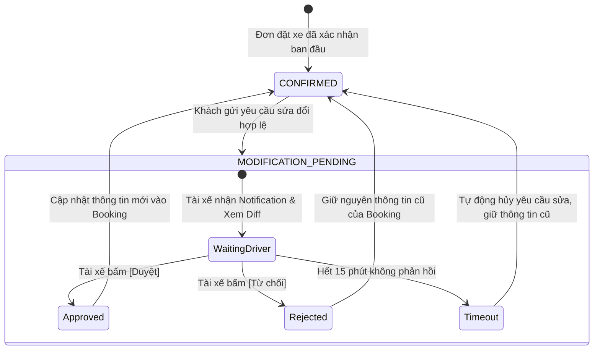
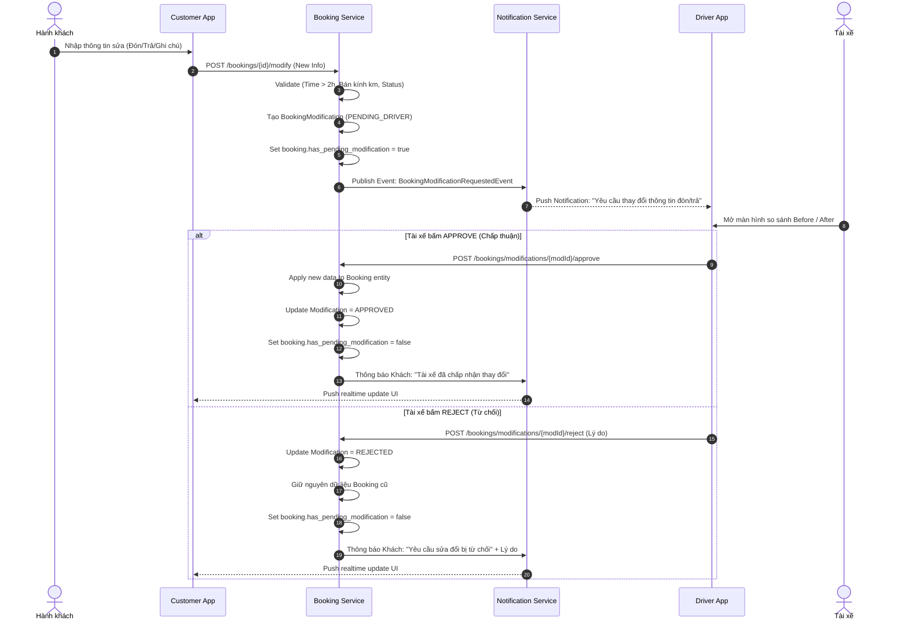
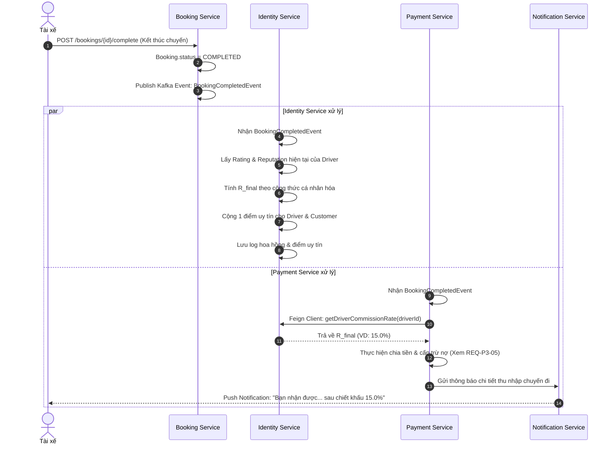
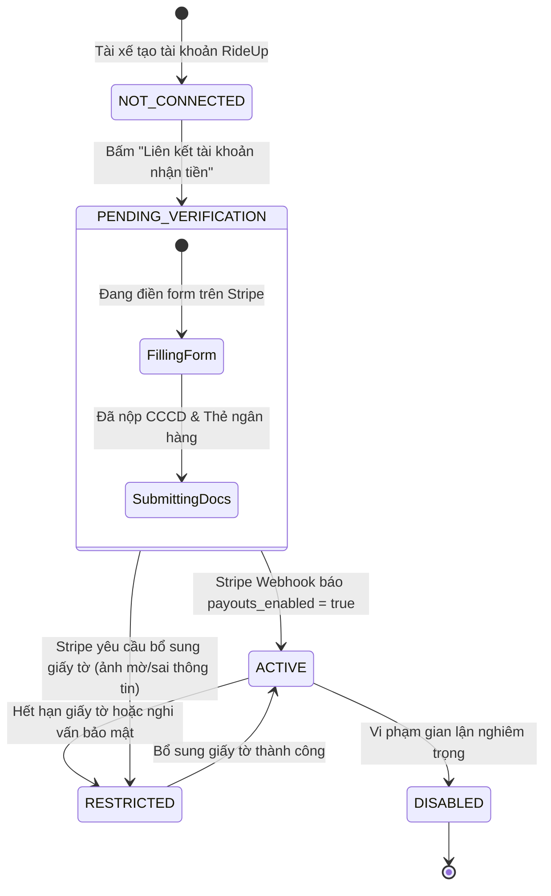
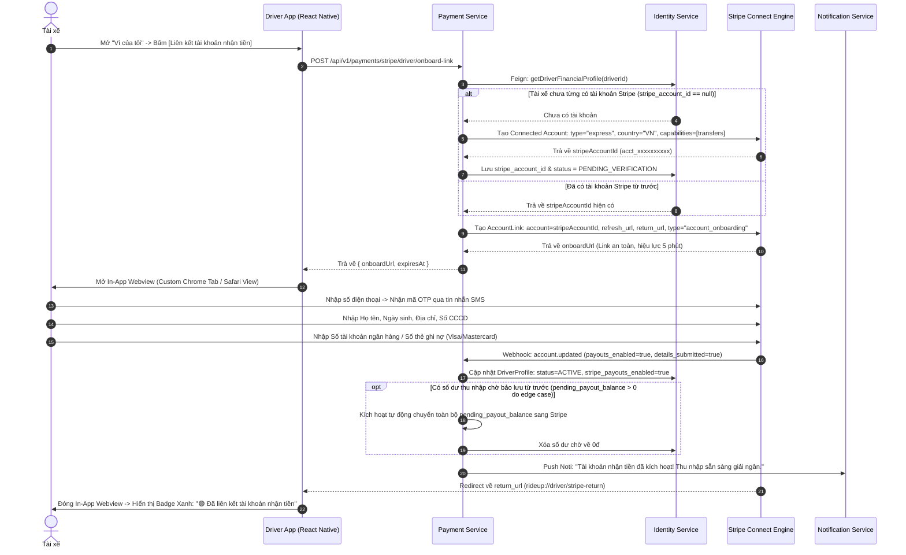
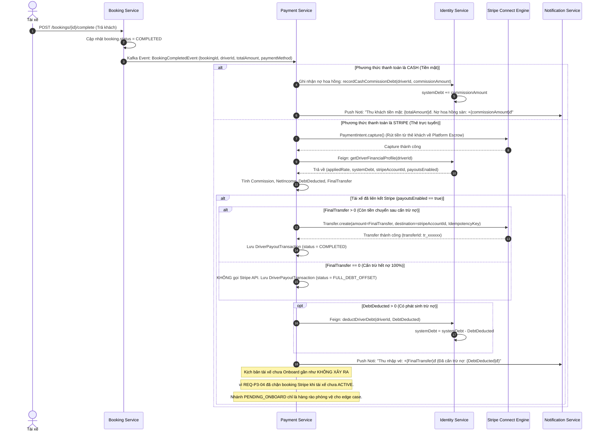
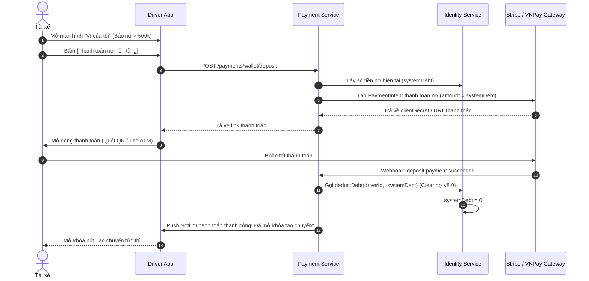

# TÀI LIỆU THIẾT KẾ NGHIỆP VỤ CHI TIẾT \- PHASE 3

# HỆ THỐNG ĐẶT XE GHÉP LIÊN TỈNH RIDEUP (RIDEUP MICROSERVICES)

---

| Thuộc tính | Giá trị chi tiết |
| :---- | :---- |
| **Dự án** | Hệ thống Đặt xe ghép liên tỉnh RideUp (RideUpMicro) |
| **Giai đoạn (Phase)** | **Phase 3 \- Nâng cấp Vận hành, Dòng tiền Trung gian Stripe & Trải nghiệm Người dùng** |
| **Đối tượng bàn giao** | Backend Team (Java Spring Boot), Frontend Mobile (React Native/Expo), Frontend Web (ReactJS Admin/Driver), QA/QC Team |
| **Trạng thái tài liệu** | Chính thức (Approved for Implementation) |
| **Ngày lập** | 17/10/2026 |

 

---

# MỤC LỤC TỔNG QUAN

1. [TỔNG QUAN NÂNG CẤP GIAI ĐOẠN 3 (PHASE 3 OVERVIEW)](#1-tổng-quan-nâng-cấp-giai-đoạn-3-phase-3-overview)  
   - 1.1. Bối cảnh và Mục tiêu kiến trúc  
   - 1.2. Danh mục 7 yêu cầu cải tiến cốt lõi  
   - 1.3. Ma trận phân bổ trách nhiệm các Microservices & Frontends  
2. [NGHIỆP VỤ 1: CHỈNH SỬA THÔNG TIN ĐẶT XE CÓ KIỂM SOÁT & TÀI XẾ DUYỆT LẠI](#2-nghiệp-vụ-1-chỉnh-sửa-thông-tin-đặt-xe-có-kiểm-soát--tài-xế-duyệt-lại)  
   - 2.1. Phân loại trường dữ liệu cho phép vs Nghiêm cấm chỉnh sửa  
   - 2.2. Điều kiện ràng buộc & Quy tắc nghiệp vụ (Validation Rules)  
   - 2.3. Vòng đời trạng thái và Mô hình dữ liệu sửa đổi (Data Model & State Machine)  
   - 2.4. Quy trình xử lý chi tiết (Happy Path, Rejection, Timeout)  
   - 2.5. Sơ đồ tuần tự tương tác (Sequence Diagram)  
   - 2.6. Đặc tả API Contracts & Kafka Events  
3. [NGHIỆP VỤ 2: TÍNH HOA HỒNG CÁ NHÂN HÓA & QUẢN TRỊ ĐIỂM UY TÍN (REPUTATION SCORE)](#3-nghiệp-vụ-2-tính-hoa-hồng-cá-nhân-hóa--quản-trị-điểm-uy-tín-reputation-score)  
   - 3.1. Thiết kế Hệ thống Điểm uy tín (Reputation Score) cho Tài xế & Hành khách  
   - 3.2. Tích hợp Đánh giá sao (Rating) theo thuật toán Bayesian Smoothing  
   - 3.3. Công thức toán học xác định % Hoa hồng cá nhân hóa tại thời điểm hoàn thành chuyến  
   - 3.4. Bảng tính ma trận hoa hồng thực nghiệm  
   - 3.5. Quy trình tính toán & Sơ đồ tuần tự (Sequence Diagram)  
   - 3.6. Cấu trúc dữ liệu & API Quản trị cấu hình hoa hồng  
4. [NGHIỆP VỤ 3: QUẢN TRỊ VIÊN CẤU HÌNH ĐỘNG BÁN KÍNH ĐÓN/TRẢ TỐI ĐA](#4-nghiệp-vụ-3-quản-trị-viên-cấu-hình-động-bán-kính-đóntrả-tối-đa)  
   - 4.1. Hiện trạng hạn chế & Mục tiêu cải tiến  
   - 4.2. Mô hình cấu hình phân cấp (Global Default & Province Override)  
   - 4.3. Công thức tính toán khoảng cách Haversine chuẩn hóa  
   - 4.4. Cơ cấu Dữ liệu Cấu hình Bán kính  
   - 4.5. Cơ chế Kiểm soát 2 lớp: Frontend Map UI & Backend Validation  
   - 4.6. Đặc tả API Cấu hình Bán kính  
5. [NGHIỆP VỤ 4: KHAI BÁO THÔNG TIN CHUYỂN KHOẢN & ONBOARDING TÀI KHOẢN STRIPE CHO TÀI XẾ (LÀM RÕ TOÀN DIỆN)](#5-nghiệp-vụ-4-khai-báo-thông-tin-chuyển-khoản--onboarding-tài-khoản-stripe-cho-tài-xế-làm-rõ-toàn-diện)  
   - 5.1. Định danh & Liên kết tài khoản qua Stripe Connect Express  
   - 5.2. Điều kiện nghiệp vụ & Ràng buộc bắt buộc Onboard trước khi khách chọn Stripe  
   - 5.3. Vòng đời Trạng thái Tài khoản Stripe (Stripe Account State Machine)  
   - 5.4. Quy trình Onboarding chi tiết qua Stripe Hosted Flow (End-to-End Workflow)  
   - 5.5. Cơ chế Đồng bộ Trạng thái Đa tầng (Multi-channel Status Synchronization)  
   - 5.6. Xử lý các Kịch bản Ngoại lệ & Trải nghiệm Người dùng (Edge Cases & Resilience)  
   - 5.7. Thiết kế Cấu trúc Dữ liệu & Bảng Thuộc tính Thực thể  
   - 5.8. Đặc tả API Contracts  
   - 5.9. Thiết kế Giao diện Người dùng trên Driver App (UI/UX Mockups)  
6. [NGHIỆP VỤ 5: CHIA TIỀN TỰ ĐỘNG TỪ STRIPE VỀ THẺ TÀI XẾ & CƠ CHẾ BÙ TRỪ NỢ TỰ ĐỘNG (LÀM RÕ TOÀN DIỆN)](#6-nghiệp-vụ-5-chia-tiền-tự-động-từ-stripe-về-thẻ-tài-xế--cơ-chế-bù-trừ-nợ-tự-động-làm-rõ-toàn-diện)  
   - 6.1. Kiến trúc Luồng tiền Trung gian Stripe Connect Escrow  
   - 6.2. Mô hình Hạch toán độc lập theo từng Booking & Phân định Cuốc Stripe vs Tiền mặt  
   - 6.3. Chính sách Phí sàn & Quy ước Tiền tệ VND  
   - 6.4. Thuật toán Cấn trừ nợ tiền mặt tự động & Xử lý triệt để 3 trường hợp nghiệp vụ  
   - 6.5. Cơ chế Phòng chống Trùng lặp Thanh toán (Idempotency)  
   - 6.6. Sơ đồ tuần tự & Logic xử lý chia tiền tự động  
   - 6.7. Quản lý Payout về Thẻ/Ngân hàng & Stripe Express Dashboard Link  
   - 6.8. Xử lý các kịch bản ngoại lệ & Cơ chế phục hồi (Edge Cases & Resilience)  
   - 6.9. Bảng Sổ cái Tài chính: driver\_payout\_transactions  
   - 6.10. Đặc tả API Sổ cái thu nhập, Dashboard Link & Giao diện Ví tài xế (Driver Wallet UI)  
7. [NGHIỆP VỤ 6: DUY TRÌ & TỐI ƯU CƠ CHẾ KIỂM SOÁT HẠN MỨC NỢ (CREDIT LIMIT), CHẶN TẠO CHUYẾN KHI DƯ NỢ TIỀN MẶT VƯỢT NGƯỠNG VÀ BÙ TRỪ QUA STRIPE](#7-nghiệp-vụ-6-duy-trì--tối-ưu-cơ-chế-kiểm-soát-hạn-mức-nợ-credit-limit-chặn-tạo-chuyến-khi-dư-nợ-tiền-mặt-vượt-ngưỡng-và-bù-trừ-qua-stripe)  
   - 7.1. Căn cứ Nghiệp vụ Kiểm soát Dư nợ Tiền mặt  
   - 7.2. Cơ chế Kiểm soát Hạn mức Tín dụng (Credit Limit Enforcement)  
   - 7.3. Luồng nạp tiền thanh toán nợ chủ động (Deposit Clear Debt)  
   - 7.4. Luồng tự động mở khóa nhờ cấn trừ qua các cuốc Stripe (Auto Offset Unblock)  
   - 7.5. Thiết kế Giao diện Cảnh báo & Điều hướng nạp tiền trên Driver App  
8. [NGHIỆP VỤ 7: KIẾN TRÚC CHỌN ĐỊA ĐIỂM KÉP (DUAL-MODE LOCATION PICKER) & BẢO ĐẢM TOÀN VẸN DỮ LIỆU](#8-nghiệp-vụ-7-kiến-trúc-chọn-địa-điểm-kép-dual-mode-location-picker--bảo-đảm-toàn-vẹn-dữ-liệu)  
   - 8.1. Căn cứ Nghiệp vụ & Kiến trúc Chọn Kép (Dual-Mode Picker)  
   - 8.2. Phương thức 1: Nhập thủ công phân cấp hành chính (Manual Hierarchical Mode)  
   - 8.3. Phương thức 2: Chọn trực quan trên bản đồ & Tuân thủ bán kính Admin (Interactive Map Mode)  
   - 8.4. Bảng so sánh đặc tính & Tình huống áp dụng của 2 Phương thức  
   - 8.5. Thuật toán bóc tách địa chỉ chi tiết sạch (Clean Granular Address Resolver)  
   - 8.6. Quy tắc Ghép chuỗi hiển thị duy nhất (Single Source of Truth)  
   - 8.7. Thiết kế Giao diện Người dùng chuyển đổi Tab (UI/UX Segmented Control)  
9. [KẾ HOẠCH BÀN GIAO & PHÂN CHIA NHIỆM VỤ CHO DEV (IMPLEMENTATION ROADMAP)](#9-kế-hoạch-bàn-giao--phân-chia-nhiệm-vụ-cho-dev-implementation-roadmap)  
   - 9.1. Ma trận phân công chi tiết theo từng Service & Frontend App  
   - 9.2. Ma trận Test Cases & Tiêu chuẩn nghiệm thu (Acceptance Criteria)

---

# 1\. TỔNG QUAN NÂNG CẤP GIAI ĐOẠN 3 (PHASE 3 OVERVIEW)

## 1.1. Bối cảnh và Mục tiêu kiến trúc

Phase 3 tập trung giải quyết 4 bài toán vận hành cốt lõi:

1. **Linh hoạt thông tin di chuyển**: Cho phép hành khách sửa điểm đón/trả, số điện thoại, ghi chú mà không cần hủy vé.  
2. **Tự động hóa dòng tiền & Kiểm soát rủi ro**: Chuyển sang thanh toán tự động qua Stripe Connect Split Payouts; cá nhân hóa hoa hồng theo Uy tín & Rating; duy trì kiểm soát hạn mức nợ tiền mặt ($CreditLimit=500.000đ$) và tự động cấn trừ qua Stripe.  
3. **Cấu hình động bán kính đón/trả**: Admin tùy biến bán kính km linh hoạt theo Tỉnh thay vì hardcode 20km.  
4. **Kiến trúc chọn địa điểm kép (Dual-Mode)**: Tách riêng Nhập tay và Chọn bản đồ, bóc tách địa chỉ sạch, xóa bỏ triệt để lỗi trùng lặp địa danh.

---

## 1.2. Danh mục 7 yêu cầu cải tiến cốt lõi

| Mã hạng mục | Tên nghiệp vụ cải tiến | Mục tiêu nghiệp vụ chính |
| :---- | :---- | :---- |
| **REQ-P3-01** | **Chỉnh sửa booking có kiểm soát** | Khách sửa điểm đón/trả/SĐT/ghi chú; tài xế duyệt/từ chối trước khi áp dụng. |
| **REQ-P3-02** | **Hoa hồng cá nhân hóa theo Uy tín & Rating** | Tính % hoa hồng động khi hoàn thành chuyến dựa trên Base rate, Reputation Score và Rating Bayesian. |
| **REQ-P3-03** | **Cấu hình động bán kính đón/trả Admin** | Cho phép Admin thiết lập bán kính km theo Tỉnh hoặc mặc định toàn sàn (Global); kiểm tra 2 lớp Web/Mobile. |
| **REQ-P3-04** | **Stripe Onboarding cho Tài xế** | Tài xế liên kết tài khoản ngân hàng qua Stripe Connect Express; khóa tùy chọn Stripe nếu chưa Onboard. |
| **REQ-P3-05** | **Chia tiền tự động Stripe & Bù trừ nợ** | Tự động Capture tiền vé, tính hoa hồng, cấn trừ nợ tiền mặt và Transfer thu nhập sạch vào Stripe tài xế. |
| **REQ-P3-06** | **Kiểm soát Credit Limit & Chặn nợ tiền mặt** | Chặn tạo chuyến khi dư nợ $\geq 500.000đ$; mở khóa linh hoạt qua Nạp tiền hoặc cấn trừ từ cuốc Stripe. |
| **REQ-P3-07** | **Dual-Mode Location Picker** | Tách 2 chế độ: Nhập thủ công phân cấp & Chọn bản đồ theo bán kính Admin; bóc tách chuỗi địa chỉ sạch. |

 

---

## 1.3. Phân bổ trách nhiệm các Module Microservices

| Module / Repository | Trách nhiệm triển khai chính trong Phase 3 |
| :---- | :---- |
| `booking-service` | Quản lý vòng đời sửa đổi Booking; chặn booking Stripe khi tài xế chưa ACTIVE; validation địa chỉ 2 chế độ. |
| `payment-service` | Stripe Connect Onboarding Link & Webhook; chia tiền tự động `Transfer.create()`; cấn trừ nợ; sổ cái Payout. |
| `identity-service` | Quản lý Stripe status, Điểm uy tín (`reputationScore`), dư nợ `systemDebt`, và tính % hoa hồng cá nhân hóa. |
| `trip-service` | Kiểm tra nợ chặn tạo chuyến khi dư nợ $\geq 500.000đ$. |
| `locationservice` | Bảng cấu hình bán kính tối đa Global & Province Override; cung cấp tọa độ tâm Phường/Xã. |
| `notification-serv` | Push notification cho sửa đổi booking, kết quả Stripe onboarding, chia tiền, cấn trừ nợ và mở khóa ví. |
| `rideup-customer` | UI sửa đổi booking; Dual-Mode Location Picker; hiển thị điểm uy tín; ẩn/khóa Stripe khi tài xế chưa Onboard. |
| `rideup-driver` | Màn hình duyệt sửa đổi; Onboarding Stripe Connect; Modal cảnh báo nợ $\geq 500k$; Ví tài xế chi tiết. |
| `rideUpMicroUi` | Admin Web: Cấu hình bán kính km; tham số hoa hồng; quản trị dư nợ & đối soát sổ cái Payout Stripe. |

 

---

# 2\. NGHIỆP VỤ 1: CHỈNH SỬA THÔNG TIN ĐẶT XE CÓ KIỂM SOÁT & TÀI XẾ DUYỆT LẠI

## 2.1. Phân loại trường dữ liệu cho phép vs Nghiêm cấm chỉnh sửa

### A. Các trường ĐƯỢC PHÉP chỉnh sửa (Allowed Fields)

1. **Điểm đón chi tiết (`pickupAddressText`, `pickupLat`, `pickupLng`, `pickupWardId`)**: Nằm trong Phường/Xã hợp lệ và không vượt quá bán kính quy định.  
2. **Điểm trả chi tiết (`dropoffAddressText`, `dropoffLat`, `dropoffLng`, `dropoffWardId`)**: Tương tự điểm đón.  
3. **Số điện thoại & Tên người đi thực tế (`passengerPhone`, `passengerName`)**: Hỗ trợ đặt hộ người thân.  
4. **Ghi chú chuyến đi (`note`)**: Thông báo thêm về hành lý hoặc người đi kèm.

### B. Các trường NGHIÊM CẤM chỉnh sửa (Strictly Forbidden Fields)

1. **Số lượng ghế (`seatCount`)**: Tránh vỡ thuật toán giữ ghế Optimistic Lock và đơn giá. Muốn đổi phải Hủy vé cũ đặt vé mới.  
2. **Mã chuyến đi (`tripId`)**: Không đổi sang chuyến khác trên cùng một booking.  
3. **Phương thức thanh toán (`paymentMethod`)**: Cố định giữa Tiền mặt (`CASH`) và Thẻ online (`STRIPE`).  
4. **Đơn giá và Tổng tiền (`pricePerSeat`, `totalAmount`)**: Bất biến.

---

## 2.2. Điều kiện ràng buộc & Quy tắc nghiệp vụ (Validation Rules)

* **Quy tắc 1 \- Trạng thái Booking**: Chỉ áp dụng khi booking là `CONFIRMED` hoặc `WAITING_DRIVER_APPROVAL`. Chặn khi chuyến đã chạy (`IN_PROGRESS`), đã xong (`COMPLETED`) hoặc đã hủy/hết hạn.  
* **Quy tắc 2 \- Khung thời gian (Cut-off Time)**: Gửi yêu cầu trước giờ khởi hành tối thiểu **02 giờ** (`trip.departureTime - now >= 2h`).  
* **Quy tắc 3 \- Giới hạn số lần (Rate Limit)**: Tối đa **02 lần thành công** mỗi booking; không gửi yêu cầu mới khi yêu cầu cũ chưa được duyệt.  
* **Quy tắc 4 \- Thời gian phản hồi của Tài xế (Timeout)**: Tài xế có **15 phút** (hoặc trước giờ xuất phát 30 phút) để duyệt. Quá hạn tự động `EXPIRED`, giữ nguyên vé gốc.

---

## 2.3. Vòng đời trạng thái và Mô hình dữ liệu sửa đổi

Hệ thống lưu vết yêu cầu sửa đổi tại bảng phụ `booking_modifications` để chờ phê duyệt, không ghi đè trực tiếp lên `Booking`.

### A. Bảng Dữ liệu: `booking_modifications` (tại `booking-service`)

| Tên trường (Column) | Kiểu dữ liệu | Ràng buộc | Ý nghĩa nghiệp vụ |
| :---- | :---- | :---- | :---- |
| `id` | `VARCHAR(36)` | `PRIMARY KEY` | Khóa chính yêu cầu sửa đổi. |
| `booking_id` | `VARCHAR(36)` | `NOT NULL, FK` | Mã đơn đặt vé cần sửa. |
| `customer_id` | `VARCHAR(36)` | `NOT NULL` | Mã hành khách yêu cầu. |
| `new_pickup_address_text` | `VARCHAR(255)` |  | Địa chỉ đón chi tiết sạch mới đề xuất. |
| `new_pickup_lat`, `_lng` | `DOUBLE PRECISION` |  | Tọa độ đón mới. |
| `new_pickup_ward_id` | `VARCHAR(50)` |  | Mã Phường/Xã đón mới. |
| `new_dropoff_address_text` | `VARCHAR(255)` |  | Địa chỉ trả chi tiết sạch mới đề xuất. |
| `new_dropoff_lat`, `_lng` | `DOUBLE PRECISION` |  | Tọa độ trả mới. |
| `new_dropoff_ward_id` | `VARCHAR(50)` |  | Mã Phường/Xã trả mới. |
| `new_passenger_name` | `VARCHAR(100)` |  | Tên người đi mới. |
| `new_passenger_phone` | `VARCHAR(20)` |  | SĐT người đi mới. |
| `new_note` | `TEXT` |  | Ghi chú chuyến đi mới. |
| `old_pickup_address_text` | `VARCHAR(255)` |  | Snapshot địa chỉ đón cũ (đối soát). |
| `old_dropoff_address_text` | `VARCHAR(255)` |  | Snapshot địa chỉ trả cũ (đối soát). |
| `old_note` | `TEXT` |  | Snapshot ghi chú cũ. |
| `status` | `VARCHAR(30)` | `NOT NULL` | `PENDING_DRIVER`, `APPROVED`, `REJECTED`, `EXPIRED`. |
| `rejection_reason` | `VARCHAR(255)` |  | Lý do từ chối (nếu tài xế từ chối). |
| `expires_at` | `TIMESTAMP` | `NOT NULL` | Thời điểm hết hạn xem xét (now \+ 15 phút). |
| `created_at`, `updated_at` | `TIMESTAMP` |  | Thời điểm tạo và cập nhật. |

 

### B. Mở rộng thực thể `Booking`

Bổ sung cờ `has_pending_modification BOOLEAN DEFAULT FALSE` vào bảng `booking` để khóa không cho gửi nhiều yêu cầu đồng thời.

---

## 2.4. Quy trình xử lý chi tiết



 

1. **Bước 1 \- Khách hàng tạo yêu cầu**:  
   - Trên Customer App, khách vào chi tiết chuyến đi đã đặt, bấm **\[Sửa thông tin chuyến\]**.  
   - Giao diện mở form cho phép sửa: Điểm đón, Điểm trả, Số điện thoại người đi, Ghi chú (Hỗ trợ 2 chế độ: Nhập thủ công hoặc Chọn trên bản đồ theo REQ-P3-07).  
   - Khi khách bấm **\[Gửi yêu cầu tài xế\]**, Frontend gọi API `POST /bookings/{id}/modify`.  
   - Backend validate các điều kiện (Thời gian \> 2h, trạng thái đơn, bán kính km).  
   - Nếu hợp lệ: Tạo bản ghi `BookingModification` với trạng thái `PENDING_DRIVER`, cập nhật `booking.has_pending_modification = true`, thời hạn hết hạn 15 phút.  
   - Gửi Push Notification cho Tài xế qua `notification-service`.  
2. **Bước 2 \- Tài xế xem xét và xử lý**:  
   - Màn hình Driver App hiển thị Popup / Tab thông báo: *"Hành khách \[Tên\] muốn thay đổi điểm đón/trả"*.  
   - Màn hình duyệt hiển thị giao diện So sánh trực quan (Before vs After):  
     + Điểm đón cũ (ghim xám) vs Điểm đón mới (ghim xanh) kèm khoảng cách lệch tính toán (VD: Lệch 1.2 km).  
     + Điểm trả cũ vs Điểm trả mới.  
     + Ghi chú cũ vs Ghi chú mới.  
3. **Bước 3 \- Các kịch bản xử lý**:  
   - **Kịch bản A: Tài xế bấm \[ĐỒNG Ý (APPROVE)\]**:  
     + Backend cập nhật `BookingModification.status = APPROVED`.  
     + Cập nhật các trường mới vào bản ghi chính `Booking`.  
     + Đặt lại `booking.has_pending_modification = false`.  
     + Bắn thông báo cho Khách: *"Tài xế đã đồng ý thay đổi thông tin chuyến đi của bạn."*  
   - **Kịch bản B: Tài xế bấm \[TỪ CHỐI (REJECT)\]**:  
     + Tài xế chọn lý do (VD: *Đường đón cấm xe ô tô*, *Lệch lộ trình quá nhiều*, *Không kịp giờ đón khách khác*).  
     + Backend cập nhật `BookingModification.status = REJECTED`.  
     + Giữ nguyên dữ liệu của `Booking`.  
     + Đặt lại `booking.has_pending_modification = false`.  
     + Bắn thông báo cho Khách: *"Tài xế từ chối thay đổi (Lý do: ...). Lộ trình cũ của bạn vẫn được giữ nguyên."*  
   - **Kịch bản C: Hết thời gian chờ (TIMEOUT)**:  
     + Job Scheduler ngầm chạy mỗi 1 phút quét các bản ghi `PENDING_DRIVER` có `expires_at < now()`.  
     + Cập nhật `BookingModification.status = TIMEOUT`.  
     + Đặt lại `booking.has_pending_modification = false`.  
     + Bắn thông báo cho Khách: *"Yêu cầu sửa đổi hết hạn do tài xế chưa kịp phản hồi. Thông tin vé cũ được giữ nguyên."*

---

## 2.5. Sơ đồ tuần tự tương tác (Sequence Diagram)



&nbsp;

---

## 2.6. Đặc tả API Contracts & Kafka Events

### API 1: Khách hàng gửi yêu cầu chỉnh sửa

* **Endpoint**: `POST /bookings/{id}/modify`  
* **Headers**: `Authorization: Bearer <jwt_token>`  
* **Request Body**:

```json
{
  "pickupAddressText": "Số 88 đường Giải Phóng",
  "pickupLat": 20.998451,
  "pickupLng": 105.841235,
  "pickupWardId": "ward_001",
  "dropoffAddressText": "Cổng Bệnh viện Đa khoa tỉnh Ninh Bình",
  "dropoffLat": 20.254122,
  "dropoffLng": 105.975412,
  "dropoffWardId": "ward_050",
  "passengerName": "Trần Thị B",
  "passengerPhone": "0987654321",
  "note": "Đổi sang số điện thoại mẹ em đi hộ, có 1 vali to"
}
```

&nbsp;

* **Response Body (200 OK)**:

```json
{
  "code": 1000,
  "message": "Gửi yêu cầu chỉnh sửa thành công. Vui lòng chờ tài xế duyệt.",
  "result": {
    "modificationId": "mod_uuid_9988",
    "bookingId": "bk_uuid_1122",
    "status": "PENDING_DRIVER",
    "expiresAt": "2026-10-17T11:45:00"
  }
}
```

&nbsp;

### API 2: Tài xế phê duyệt yêu cầu sửa đổi

* **Endpoint**: `POST /bookings/modifications/{modId}/approve`  
* **Response Body (200 OK)**:

```json
{
  "code": 1000,
  "message": "Phê duyệt thay đổi thành công. Thông tin chuyến đi đã được cập nhật.",
  "result": {
    "bookingId": "bk_uuid_1122",
    "status": "CONFIRMED"
  }
}
```

&nbsp;

### API 3: Tài xế từ chối yêu cầu sửa đổi

* **Endpoint**: `POST /bookings/modifications/{modId}/reject`  
* **Request Body**:

```json
{
  "reason": "Điểm đón mới đi vào ngõ hẹp xe 7 chỗ không quay đầu được"
}
```

&nbsp;

---

# 3\. NGHIỆP VỤ 2: TÍNH HOA HỒNG CÁ NHÂN HÓA & QUẢN TRỊ ĐIỂM UY TÍN (REPUTATION SCORE)

## 3.1. Thiết kế Hệ thống Điểm uy tín (Reputation Score) cho Tài xế & Hành khách

Nhằm tạo động lực cung cấp dịch vụ xuất sắc và loại bỏ triệt để vấn nạn hủy chuyến vô tội vạ, hệ thống xây dựng cơ chế **Điểm uy tín (Reputation Score)** định danh cho cả Tài xế và Hành khách.

### A. Thang điểm & Giá trị khởi tạo

* **Thang điểm**: $0$ đến $100$ điểm.  
* **Điểm mặc định ban đầu**:  
  - Tài xế mới được duyệt hồ sơ: **80 điểm**.  
  - Khách hàng mới đăng ký tài khoản: **80 điểm**.

### B. Quy tắc biến động Điểm uy tín Tài xế (Driver Reputation Rules)

1. **Hoàn thành chuyến đi (`COMPLETED`)**: $+1$ điểm/chuyến (tối đa không vượt quá 100 điểm).  
2. **Được khách hàng đánh giá 5 sao**: $+1$ điểm.  
3. **Tài xế chủ động HỦY CHUYẾN sau khi đã duyệt vé (`CONFIRMED`)**:  
   - Hủy trước giờ khởi hành $>12$ tiếng: Trừ **5 điểm**.  
   - Hủy trước giờ khởi hành từ $2$ đến $12$ tiếng: Trừ **10 điểm**.  
   - Hủy trước giờ khởi hành $<2$ tiếng (Hủy cận giờ): Trừ **20 điểm**.  
4. **Bỏ rơi khách / Không đón khách đã chốt**: Trừ **30 điểm** \+ Khóa tài khoản tạm thời để Admin kiểm tra.

### C. Quy tắc biến động Điểm uy tín Khách hàng (Customer Reputation Rules)

1. **Hoàn thành chuyến đi trọn vẹn**: $+1$ điểm (tối đa 100 điểm).  
2. **Khách hàng HỦY VÉ sau khi tài xế đã duyệt (`CONFIRMED`)**:  
   - Hủy trước giờ xuất phát $>6$ tiếng: Trừ **2 điểm**.  
   - Hủy trước giờ xuất phát $<2$ tiếng: Trừ **10 điểm**.  
   - Bùng xe (No-show \- xe đến điểm đón nhưng khách không có mặt, không nghe máy): Trừ **20 điểm**.  
3. **Hiển thị minh bạch**: Điểm uy tín của khách hàng được hiển thị trực tiếp tại màn hình chờ duyệt của tài xế (VD: *"Khách hàng: Nguyễn Văn A \- Điểm uy tín: 95/100 (Rất uy tín)"*), giúp tài xế hoàn toàn yên tâm chấp thuận đơn.

---

## 3.2. Tích hợp Đánh giá sao (Rating) theo thuật toán Bayesian Smoothing

Hệ thống đã triển khai sẵn công thức tính điểm đánh giá trung bình làm mịn Bayes (Bayesian Average) tại `review-service`: $${R}_{bayesian}=\frac{(W\times C)+(R\times v)}{W+v}$$

&nbsp;Trong đó:

- $C=5.0$ (Điểm chuẩn mặc định ban đầu).  
- $W=5$ (Số lượng đánh giá tối thiểu quy ước để làm mịn).  
- $R$: Điểm đánh giá trung bình số học thực tế của khách hàng.  
- $v$: Tổng số lượt đánh giá tài xế đã nhận được.

*Kết quả được làm tròn 1 chữ số thập phân, lưu trong `DriverProfile.driverRating`.*

---

## 3.3. Công thức toán học xác định % Hoa hồng cá nhân hóa tại thời điểm hoàn thành chuyến

### A. Thời điểm chốt hoa hồng

Tỷ lệ hoa hồng cá nhân hóa được chốt và áp dụng **DUY NHẤT TẠI THỜI ĐIỂM CHUYẾN XE HOÀN THÀNH (`COMPLETED`)**. Không sử dụng tỷ lệ tại thời điểm đặt xe, vì trong suốt hành trình tài xế có thể nhận thêm review hoặc vi phạm hủy chuyến khác làm thay đổi uy tín.

### B. Các tham số cấu hình hệ thống (Admin System Settings)

1. ${R}_{base}$: Tỷ lệ hoa hồng cơ sở (Admin cấu hình, mặc định \= **$18\%$** hoặc **$20\%$**).
2. ${R}_{min}$: Mức hoa hồng sàn tối thiểu (Default \= **$12\%$** \- mức ưu đãi cao nhất dành cho tài xế VIP).
3. ${R}_{max}$: Mức hoa hồng trần tối đa (Default \= **$25\%$** \- mức phạt đối với tài xế có tỷ lệ hủy chuyến cao/rating kém).  
4. $Benchmar{k}_{rating}=4.5$ (Ngưỡng rating chuẩn).  
5. $Benchmar{k}_{reputation}=80$ (Ngưỡng uy tín chuẩn).

### C. Công thức tính toán chi tiết

Tỷ lệ hoa hồng điều chỉnh được tính theo công thức: $${R}_{applied}={R}_{base}-{\Delta }_{rating}-{\Delta }_{reputation}$$

Trong đó:

1. **Hệ số thưởng/phạt theo Rating (${\Delta }_{rating}$)**: $$\Delta_{rating} = (Rating_{bayesian} - 4.5) \times 2\%$$
   - Nếu $Rating = 5.0 \implies \Delta_{rating} = +1.0\%$ (Được giảm $1.0\%$ hoa hồng).
   - Nếu $Rating = 4.0 \implies \Delta_{rating} = -1.0\%$ (Bị phạt tăng $1.0\%$ hoa hồng).
2. **Hệ số thưởng/phạt theo Điểm uy tín (${\Delta }_{reputation}$)**: $$\Delta_{reputation} = \frac{ReputationScore - 80}{10} \times 1.0\%$$
   - Nếu $Reputation = 100 \implies \Delta_{reputation} = +2.0\%$ (Được giảm $2.0\%$ hoa hồng).
   - Nếu $Reputation = 60 \implies \Delta_{reputation} = -2.0\%$ (Bị phạt tăng $2.0\%$ hoa hồng).
3. **Áp dụng cận biên an toàn (Clamping)**: $$R_{final} = \max\Big(R_{min}, \min\big(R_{max}, R_{applied}\big)\Big)$$

---

## 3.4. Bảng tính ma trận hoa hồng thực nghiệm (với $R_{base} = 18\%$)

| Xếp hạng tài xế | Điểm Rating | Điểm Uy tín | ${\Delta }_{rating}$ | ${\Delta }_{reputation}$ | ${R}_{applied}$ | ${R}_{final}$ áp dụng | Ý nghĩa nghiệp vụ |
| :---- | :---: | :---: | :---: | :---: | :---: | :---: | :---- |
| **Tài xế Xuất sắc (VIP)** | 5.0 | 100 | $+1.0\%$ | $+2.0\%$ | $15.0\%$ | **15.0%** | Giảm $3\%$ phí sàn, thưởng tối đa tài xế giữ xe chuẩn 5 sao và không hủy đơn. |
| **Tài xế Tốt** | 4.8 | 90 | $+0.6\%$ | $+1.0\%$ | $16.4\%$ | **16.4%** | Giảm $1.6\%$ phí sàn, khuyến khích nâng cấp dịch vụ. |
| **Tài xế Mới / Trung bình** | 4.5 | 80 | $0.0\%$ | $0.0\%$ | $18.0\%$ | **18.0%** | Áp dụng đúng mức chuẩn cơ sở của hệ thống. |
| **Tài xế Cảnh báo** | 4.2 | 70 | $-0.6\%$ | $-1.0\%$ | $19.6\%$ | **19.6%** | Tăng $1.6\%$ phí hoa hồng do có lịch sử hủy chuyến. |
| **Tài xế Vi phạm nhiều** | 3.8 | 50 | $-1.4\%$ | $-3.0\%$ | $22.4\%$ | **22.4%** | Phạt nặng, thu hồi lợi nhuận bù đắp chi phí chăm sóc khách hàng. |
| **Tài xế Báo động đỏ** | 3.0 | 30 | $-3.0\%$ | $-5.0\%$ | $26.0\%$ | **25.0%** (Chạm trần) | Đạt ngưỡng trần $25\%$, hệ thống tự động đưa vào danh sách xem xét đình chỉ. |

&nbsp;

---

## 3.5. Quy trình tính toán & Sơ đồ tuần tự (Sequence Diagram)



&nbsp;

---

## 3.6. Cấu trúc dữ liệu & API Quản trị cấu hình hoa hồng

### Bổ sung vào bảng `DriverProfile` (identity-service):

* `reputation_score INT DEFAULT 80`  
* `total_completed_trips INT DEFAULT 0`  
* `total_cancelled_trips INT DEFAULT 0`

### Bổ sung vào bảng `User` (identity-service):

* `customer_reputation_score INT DEFAULT 80`

### API Endpoint: Lấy tỷ lệ hoa hồng thời gian thực

* **Endpoint**: `GET /api/v1/identity/drivers/{driverId}/commission-rate`  
* **Response**:

```json
{
  "code": 1000,
  "result": {
    "driverId": "driver_uuid_111",
    "baseRate": 0.18,
    "currentRating": 4.9,
    "reputationScore": 95,
    "appliedCommissionRate": 0.157,
    "discountPercent": 2.3
  }
}
```

&nbsp;

---

# 4\. NGHIỆP VỤ 3: QUẢN TRỊ VIÊN CẤU HÌNH ĐỘNG BÁN KÍNH ĐÓN/TRẢ TỐI ĐA

## 4.1. Hiện trạng hạn chế & Mục tiêu cải tiến

* **Hiện trạng**: Trong Phase 1 & 2, giá trị khoảng cách đón/trả tối đa đang bị gán cứng trong mã nguồn:  
  - `const MAX_DISTANCE_METERS = 20000;` (20 km) tại các file: [LocationMapPicker.js (Customer)](file:///c:/Users/Admin/Documents/WorkSpace/RideUpMicro/rideup-customer-app/src/components/LocationMapPicker.js), [LocationMapPicker.js (Driver)](file:///c:/Users/Admin/Documents/WorkSpace/RideUpMicro/rideup-driver-app/src/components/LocationMapPicker.js) và [LocationMapPicker.jsx (Admin Web)](file:///c:/Users/Admin/Documents/WorkSpace/RideUpMicro/rideUpMicroUi/src/components/common/LocationMapPicker.jsx).  
  - Backend chưa có cơ chế kiểm tra đồng bộ dẫn đến nguy cơ gian lận gọi thẳng API để đặt điểm đón cách xa hàng chục cây số gây vỡ lộ trình.  
* **Mục tiêu**:  
  - Chuyển đổi toàn bộ việc quản trị bán kính sang cơ sở dữ liệu động.  
  - Cung cấp giao diện Admin Web cho phép tùy chỉnh thông số toàn hệ thống và tùy chỉnh riêng cho từng địa phương.  
  - Kiểm tra 2 lớp: Frontend chặn chọn trên bản đồ \+ Backend chặn ghi nhận đơn.

---

## 4.2. Mô hình cấu hình phân cấp (Global Default & Province Override)

Để vừa đảm bảo sự linh hoạt tối đa vừa không phải nhập liệu thủ công cho toàn bộ 63 tỉnh/thành phố, hệ thống áp dụng nguyên lý kế thừa phân cấp:

1. **Cấu hình toàn cục (Global Default)**: Áp dụng mặc định cho tất cả các tỉnh thành không có cấu hình riêng (Giá trị khuyến nghị: **20 km**).  
2. **Cấu hình ghi đè theo tỉnh (Province Override)**:  
   - Các đô thị loại đặc biệt có mật độ giao thông đông đúc, đường hẹp (VD: **Hà Nội**, **TP. Hồ Chí Minh**): Cấu hình siết chặt **8 \- 10 km** để tránh tài xế phải chạy quá sâu vào vùng kẹt xe.  
   - Các tỉnh miền núi, địa bàn rộng, thưa dân (VD: **Lào Cai**, **Sơn La**, **Gia Lai**): Cấu hình mở rộng **30 \- 35 km** phù hợp với thực tế đón khách tận bản/xã.

---

## 4.3. Công thức tính toán khoảng cách Haversine chuẩn hóa

Khoảng cách từ tọa độ đón/trả do khách hàng chọn $(la{t}_{p},ln{g}_{p})$ đến tọa độ tâm hành chính Phường/Xã $(la{t}_{w},ln{g}_{w})$ được tính theo công thức Haversine mặt cầu:

$$a={\sin }^{2}\left({\frac{\Delta lat}{2}}\right)+\cos (la{t}_{w})\cdot \cos (la{t}_{p})\cdot {\sin }^{2}\left({\frac{\Delta lng}{2}}\right)$$

&nbsp;$$c = 2 \cdot \text{atan2}\left(\sqrt{a}, \sqrt{1 - a}\right)$$ $$Distance=R\cdot c$$

&nbsp;*(Trong đó bán kính Trái Đất $R = 6,371,000\text{ mét}$)*.

---

## 4.4. Cơ cấu Dữ liệu Cấu hình Bán kính

### Bảng Dữ liệu: `location_distance_configs` (tại `locationservice`)

| Tên trường (Column) | Kiểu dữ liệu | Ràng buộc | Ý nghĩa nghiệp vụ |
| :---- | :---- | :---- | :---- |
| `id` | `VARCHAR(36)` | `PRIMARY KEY` | Khóa chính bản ghi cấu hình. |
| `province_id` | `VARCHAR(50)` | `UNIQUE, NULLABLE` | Mã Tỉnh/TP áp dụng. `NULL` nếu là cấu hình toàn hệ thống (Global Default). |
| `max_distance_km` | `DECIMAL(5,2)` | `NOT NULL` | Bán kính đón/trả tối đa (km) cho phép ghim điểm (VD: 10km Hà Nội, 35km Lào Cai). |
| `description` | `VARCHAR(255)` |  | Ghi chú lý do cấu hình. |
| `is_active` | `BOOLEAN` | `DEFAULT TRUE` | Trạng thái kích hoạt. |
| `created_at`, `updated_at` | `TIMESTAMP` |  | Thời điểm tạo và cập nhật. |

&nbsp;

---

## 4.5. Cơ chế Kiểm soát 2 lớp: Frontend Map UI & Backend Validation

```
[Khách hàng ghim điểm trên Map]
            │
            ▼
[Layer 1: Frontend Map Validation]
   - Fetch: GET /locations/config/max-distance?provinceId=...
   - Render vòng tròn bán kính trên Bản đồ (Circle overlay)
   - Tính Haversine Client: nếu distance > max_distance:
        -> Báo đỏ: "Vị trí nằm ngoài bán kính cho phép (tối đa X km)"
        -> Khóa nút "Xác nhận điểm đón"
            │
            ▼ (Nếu cố tình bypass gọi API)
[Layer 2: Backend Business Validation (booking-service)]
   - Lấy WardCenter của pickupWardId & dropoffWardId từ locationservice
   - Tính khoảng cách Haversine chuẩn tại Server
   - Nếu distance > configured_max_distance:
        -> Throw AppException(ErrorCode.LOCATION_OUT_OF_BOUNDS)
        -> Chặn không tạo Booking
```

&nbsp;

---

## 4.6. Đặc tả API Cấu hình Bán kính

### API 1: Client lấy cấu hình bán kính hiệu lực của Tỉnh

* **Endpoint**: `GET /api/v1/locations/config/max-distance?provinceId={provinceId}`  
* **Response (200 OK)**:

```json
{
  "code": 1000,
  "result": {
    "provinceId": "01",
    "provinceName": "Thành phố Hà Nội",
    "maxDistanceKm": 10.0,
    "maxDistanceMeters": 10000,
    "isOverridden": true
  }
}
```

&nbsp;

### API 2: Admin cập nhật cấu hình bán kính

* **Endpoint**: `PUT /api/v1/admin/locations/config/max-distance`  
* **Request Body**:

```json
{
  "provinceId": "01",
  "maxDistanceKm": 12.0,
  "description": "Nâng bán kính Hà Nội lên 12km theo kiến nghị tài xế"
}
```

&nbsp;

---

# 5\. NGHIỆP VỤ 4: KHAI BÁO THÔNG TIN CHUYỂN KHOẢN & ONBOARDING TÀI KHOẢN STRIPE CHO TÀI XẾ (LÀM RÕ TOÀN DIỆN)

## 5.1. Định danh & Liên kết tài khoản qua Stripe Connect Express

RideUp ứng dụng mô hình **Stripe Connect Express Hosted Flow** để tự động hóa toàn bộ việc định danh và giải ngân:

* **Bảo mật chuẩn quốc tế**: Nền tảng không lưu trữ số tài khoản ngân hàng hay ảnh CCCD trên máy chủ, tuân thủ chuẩn PCI-DSS.  
* **Giao diện chuẩn hóa**: Tài xế thực hiện định danh trên giao diện an toàn do Stripe vận hành (hỗ trợ tiếng Việt, xác thực OTP qua SMS).  
* **Giải ngân tự động**: Thu nhập từ chuyến xe Stripe được chuyển vào Connected Account và Stripe tự động điều phối rút về thẻ ATM ngân hàng nội địa (VCB, TCB, MB,...) hoặc thẻ ghi nợ của tài xế.

---

## 5.2. Điều kiện nghiệp vụ & Ràng buộc bắt buộc Onboard trước khi khách chọn Stripe

Hệ thống thiết kế luồng Onboard theo triết lý **"Giảm thiểu rào cản gia nhập (Progressive Onboarding)"** nhằm không làm nản lòng tài xế mới, nhưng đồng thời **đảm bảo tuyệt đối rằng chức năng thanh toán Stripe chỉ được kích hoạt khi tài xế đã hoàn tất Onboard**:

```
┌────────────────────────────────────────────────────────────────────────────────────────┐
│               VÒNG ĐỜI YÊU CẦU ONBOARD STRIPE CỦA ĐỐI TÁC TÀI XẾ                       │
├──────────────────────┬─────────────────────────────────────────────────────────────────┤
│ Giai đoạn hoạt động  │ Hành vi hệ thống & Phương thức thanh toán khả dụng               │
├──────────────────────┼─────────────────────────────────────────────────────────────────┤
│ 1. Đăng ký tài khoản │ Tài xế chỉ cần nộp bằng lái, giấy tờ xe là được duyệt chạy.     │
│    và duyệt hồ sơ xe │ CHƯA BẮT BUỘC Onboard Stripe tại bước này.                      │
├──────────────────────┼─────────────────────────────────────────────────────────────────┤
│ 2. Nhận khách & chạy │ Khách hàng đặt vé với tài xế này CHỈ ĐƯỢC CHỌN TIỀN MẶT (CASH). │
│    (Chưa Onboard)    │ Tùy chọn "Thanh toán qua Stripe" bị ẨN / VÔ HIỆU HÓA.          │
├──────────────────────┼─────────────────────────────────────────────────────────────────┤
│ 3. Tài xế Onboard    │ Khi stripe_account_status = ACTIVE & payouts_enabled = true:     │
│    Stripe thành công │ ➜ HỆ THỐNG MỞ KHÓA phương thức Stripe cho tất cả các booking    │
│    (ACTIVE)          │   đặt vé với tài xế này. Khách được chọn CASH hoặc STRIPE.       │
│                      │ ➜ Tài xế sẵn sàng nhận tiền tự động về thẻ ngân hàng.            │
└──────────────────────┴─────────────────────────────────────────────────────────────────┘
```

&nbsp;

### QUY TẮC NGHIỆP VỤ THEN CHỐT: TÀI XẾ PHẢI ONBOARD STRIPE → KHÁCH MỚI ĐƯỢC CHỌN THANH TOÁN STRIPE

> \[\!IMPORTANT\] **RÀNG BUỘC BẮT BUỘC**: Tài xế **PHẢI hoàn tất Onboarding Stripe** (trạng thái tài khoản đạt mức `ACTIVE`, tức `stripe_payouts_enabled = true` VÀ `stripe_details_submitted = true`) **TRƯỚC KHI** khách hàng được phép chọn phương thức thanh toán Stripe khi đặt vé với tài xế đó. Đây là điều kiện tiên quyết bắt buộc, không có ngoại lệ.

**Chi tiết các ràng buộc thực thi tại từng điểm kiểm soát nghiệp vụ:**

1. **Ràng buộc tại giao diện Customer App (Lớp Frontend \- UX)**:

   - Khi khách hàng vào màn hình đặt vé của một chuyến xe, Customer App gọi API lấy thông tin chuyến kèm trạng thái Stripe của tài xế: $$\text{GET /api/v1/trips/\{tripId\}/payment-options}$$  
   - **Tài xế đã Onboard (`stripe_account_status == ACTIVE`)**:  
     * Hiển thị **đầy đủ 2 lựa chọn** phương thức thanh toán: `[ 💵 Tiền mặt ]` và `[ 💳 Thanh toán qua Stripe ]`.  
   - **Tài xế chưa Onboard (`stripe_account_status != ACTIVE`)**:  
     * **Ẩn hoàn toàn** hoặc **Vô hiệu hóa (Disabled \+ Gạch xám)** tùy chọn `Thanh toán qua Stripe`.  
     * Chỉ hiển thị duy nhất: `[ 💵 Tiền mặt (Phương thức duy nhất khả dụng) ]`.  
     * *(Tùy chọn)* Hiển thị ghi chú nhỏ: *"Tài xế chưa hỗ trợ thanh toán trực tuyến. Vui lòng thanh toán bằng tiền mặt."*  
2. **Ràng buộc tại Backend Validation (Lớp Backend \- An toàn)**:

   - Tại `booking-service`, khi tiếp nhận yêu cầu tạo booking (`POST /bookings`):  
     * Nếu `request.paymentMethod == STRIPE`: Backend bắt buộc gọi `identity-service` kiểm tra `stripe_account_status` của tài xế sở hữu chuyến xe (`tripId → driverId → DriverProfile`).  
     * Nếu `stripe_account_status != ACTIVE`: **Từ chối tạo booking ngay lập tức** với mã lỗi:  
       > `ErrorCode.DRIVER_STRIPE_NOT_ONBOARDED`: *"Tài xế chưa kích hoạt thanh toán trực tuyến. Vui lòng chọn phương thức Tiền mặt (CASH)."*  
     * Quy tắc này đóng vai trò **hàng rào an toàn cuối cùng**, chặn mọi nỗ lực bypass giao diện (gọi API trực tiếp) để tạo booking Stripe với tài xế chưa Onboard.  
3. **Ràng buộc tại giao diện Driver App (Động lực Onboard)**:

   - Trên màn hình chính Driver App, hiển thị Banner khuyến khích khi tài xế chưa Onboard:  
     > 💡 *"Liên kết tài khoản nhận tiền để mở khóa thanh toán trực tuyến\! Khách hàng sẽ có thêm lựa chọn thanh toán qua Stripe, giúp bạn nhận nhiều đơn hơn và thu nhập tự động về thẻ ngân hàng."*  
   - Màn hình Ví tài xế hiển thị rõ trạng thái:  
     * 🔴 **Chưa liên kết**: *"Khách hàng chỉ có thể thanh toán bằng tiền mặt với bạn."*  
     * 🟢 **Đã liên kết (ACTIVE)**: *"Khách hàng có thể thanh toán qua Stripe. Thu nhập tự động về thẻ ngân hàng."*  
4. **Lợi ích nghiệp vụ của quy tắc này**:

   - **Loại bỏ hoàn toàn kịch bản tiền "treo"**: Không còn trường hợp hệ thống capture tiền khách qua Stripe nhưng không thể Transfer cho tài xế vì chưa Onboard, tránh phát sinh `pending_payout_balance` và nợ kỹ thuật.  
   - **Tạo động lực tự nhiên cho tài xế Onboard**: Khi tài xế thấy rằng việc Onboard mở ra nguồn khách hàng thanh toán online (thường chiếm 40-60% thị trường), họ sẽ chủ động liên kết tài khoản nhận tiền.  
   - **Đơn giản hóa luồng chia tiền (REQ-P3-05)**: `payment-service` khi xử lý cuốc Stripe hoàn thành luôn chắc chắn tài xế đã có `stripeAccountId` hợp lệ và `payouts_enabled = true`, không cần xử lý nhánh `PENDING_ONBOARD` phức tạp.

> \[\!NOTE\] **Trường hợp đặc biệt (Edge Case)**: Nếu tài xế Onboard thành công rồi sau đó bị Stripe chuyển sang `RESTRICTED` (hết hạn giấy tờ, nghi vấn bảo mật), hệ thống tự động chuyển lại trạng thái → Khách đặt mới chỉ được chọn Tiền mặt. Các cuốc Stripe **đang diễn ra** (đã tạo booking trước khi bị Restricted) vẫn được xử lý bình thường để không ảnh hưởng đến hành khách đã thanh toán.

---

## 5.3. Vòng đời Trạng thái Tài khoản Stripe (Stripe Account State Machine)

Trạng thái kết nối tài chính của tài xế được theo dõi nghiêm ngặt qua mô hình máy trạng thái:



&nbsp;

### Bảng Ý nghĩa Trạng thái Định danh Tài chính

| Trạng thái | Thuộc tính DB (`stripe_account_status`) | Điều kiện cờ Stripe | Khả năng Nhận tiền Transfer & Rút tiền Payout |
| :---- | :---- | :---- | :---- |
| **Chưa liên kết** | `NOT_CONNECTED` | `stripe_account_id IS NULL` | **Không khả dụng**. Tài xế chỉ nhận cuốc TIỀN MẶT; hệ thống khóa tùy chọn Stripe đối với hành khách khi đặt chuyến này. |
| **Đang xác thực** | `PENDING_VERIFICATION` | `details_submitted = false` | **Chưa**. Tài xế đang điền thông tin hoặc Stripe đang kiểm tra CCCD. |
| **Sẵn sàng hoạt động** | **`ACTIVE`** | `payouts_enabled = true` & `details_submitted = true` | **Sẵn sàng 100%**. Tiền chuyển tức thì sang tài xế và tự động rút về thẻ ATM. |
| **Cần bổ sung giấy tờ** | `RESTRICTED` | `requirements.currently_due > 0` | **Tạm khóa giải ngân**. Cần bổ sung lại ảnh chụp CCCD hoặc sao kê ngân hàng. |
| **Bị vô hiệu hóa** | `DISABLED` | `account.disabled = true` | **Bị khóa vĩnh viễn**. Chặn hoàn toàn hoạt động tài chính trên nền tảng. |

&nbsp;

---

## 5.4. Quy trình Onboarding chi tiết qua Stripe Hosted Flow (End-to-End Workflow)

Toàn bộ quy trình diễn ra khép kín, an toàn tuyệt đối với trải nghiệm mượt mà trên ứng dụng di động của tài xế:



&nbsp;

### Chi tiết 7 bước nghiệp vụ tiêu chuẩn

1. **Bước 1 \- Khởi tạo yêu cầu**: Tài xế vào màn hình Ví trên [rideup-driver-app](file:///c:/Users/Admin/Documents/WorkSpace/RideUpMicro/rideup-driver-app), bấm nút **\[Liên kết tài khoản nhận tiền\]**. App gửi yêu cầu `POST /payments/stripe/driver/onboard-link`.  
2. **Bước 2 \- Kiểm tra & Tạo tài khoản Stripe**:  
   - `payment-service` kiểm tra xem tài xế đã có `stripe_account_id` trong hồ sơ `identity-service` hay chưa.  
   - Nếu chưa: Gọi lệnh tạo tài khoản Express mới trên Stripe với quyền năng chuyển tiền (`transfers`). Lưu mã tài khoản định danh `acct_xxxxxxxxxx` vào CSDL với trạng thái `PENDING_VERIFICATION`.  
3. **Bước 3 \- Sinh Onboard URL an toàn**:  
   - Backend gọi Stripe API sinh `AccountLink` chứa 2 đường dẫn điều hướng ngược (Deep Links):  
     * `return_url`: `rideup://driver/stripe-return` (Đích đến khi hoàn tất thành công).  
     * `refresh_url`: `rideup://driver/stripe-refresh` (Đích đến khi phiên hết hạn hoặc lỗi mạng để sinh lại link).  
   - Đường dẫn này có thời hạn bảo mật **05 phút**.  
4. **Bước 4 \- Mở giao diện định danh bảo mật**:  
   - Ứng dụng Driver App mở In-App Browser (Safari View Controller trên iOS hoặc Chrome Custom Tabs trên Android) đưa tài xế sang cổng bảo mật của Stripe.  
5. **Bước 5 \- Tài xế khai báo thông tin trên Stripe**:  
   - Nhập số điện thoại di động chính chủ $\rightarrow$ Nhận mã xác thực OTP $6$ số qua SMS.  
   - Khai báo thông tin định danh: Họ tên, Ngày tháng năm sinh, Địa chỉ cư trú, Số CCCD.  
   - Khai báo phương thức nhận tiền: Số tài khoản ngân hàng nội địa hoặc Số thẻ ghi nợ (Debit Card).  
6. **Bước 6 \- Xử lý đồng bộ tự động**:  
   - Ngay khi tài xế bấm xác nhận trên Stripe, hệ thống đồng bộ trạng thái qua 2 kênh: Webhook bất đồng bộ phía máy chủ và Deep Link phía ứng dụng di động.  
7. **Bước 7 \- Kích hoạt tài chính & Mở khóa thanh toán trực tuyến**:  
   - Tài khoản được gắn cờ `ACTIVE`. Hệ thống tự động **mở khóa tùy chọn thanh toán Stripe** cho các hành khách khi đặt vé chuyến xe của tài xế này.  
   - Nếu tài xế có số dư bảo lưu tồn đọng từ trước (do từng bị `RESTRICTED` ở chuyến trước), hệ thống tự động quét và giải ngân nốt số dư `pending_payout_balance` sang tài khoản Stripe.

---

## 5.5. Cơ chế Đồng bộ Trạng thái Đa tầng (Multi-channel Status Synchronization)

Nhằm đảm bảo trải nghiệm người dùng luôn mượt mà tức thì và dữ liệu không bao giờ bị lệch giữa RideUp và Stripe, hệ thống triển khai cơ chế đồng bộ song song 2 kênh:

### A. Kênh 1: Stripe Webhook (`account.updated`) \- Kênh Chính thống & Đáng tin cậy nhất

* Khi thông tin tài khoản tài xế có bất kỳ biến động nào (vừa điền xong form, bổ sung CCCD thành công, hoặc bị Stripe tạm khóa), Stripe tự động phát Webhook Event `account.updated` về `payment-service`.  
* **Quy trình xử lý tại Backend**:  
  1. **Xác thực Chữ ký số (Stripe-Signature)**: Sử dụng Webhook Signing Secret để chứng thực gói tin 100% xuất phát từ máy chủ Stripe, chống tấn công giả mạo (Man-in-the-middle).  
  2. **Trích xuất thông số then chốt**:  
     - `account.details_submitted`: Tài xế đã hoàn tất gửi thông tin chưa?  
     - `account.payouts_enabled`: Tài khoản đã đủ điều kiện rút tiền về ngân hàng chưa?  
     - `account.requirements.currently_due`: Danh sách giấy tờ cần bổ sung (nếu có).  
  3. **Đồng bộ sang `identity-service`**:  
     - Nếu cả 2 cờ đều là `true`: Cập nhật `stripe_account_status = ACTIVE`, `stripe_payouts_enabled = true`.  
     - Kích hoạt mở khóa phương thức thanh toán Stripe cho các chuyến xe của tài xế.  
     - Đồng thời kích hoạt giải phóng `pending_payout_balance` cho tài xế (nếu có số dư bảo lưu từ edge case).  
     - Bắn thông báo đẩy (Push Notification) chúc mừng tài xế qua `notification-service`.

### B. Kênh 2: Client Active Polling (Khi App mở lại từ Deep Link) \- Trải nghiệm Tức thì

* Khi tài xế hoàn tất trên Stripe và được redirect về ứng dụng theo đường dẫn `rideup://driver/stripe-return`:  
* Đôi khi Webhook từ Stripe về máy chủ Backend có thể bị trễ từ $1-3$ giây do độ trễ mạng quốc tế. Để tài xế không phải chờ đợi nhìn màn hình cũ, Driver App sẽ chủ động gọi ngay API: $$\text{GET /api/v1/payments/stripe/driver/account-status}$$  
* Backend kiểm tra trực tiếp trạng thái tài khoản từ Stripe Cache/API và trả về kết quả ngay lập tức để App cập nhật giao diện thành "Đã liên kết" trong chớp mắt.

---

## 5.6. Xử lý các Kịch bản Ngoại lệ & Trải nghiệm Người dùng (Edge Cases & Resilience)

1. **Tài xế tắt app giữa chừng hoặc Onboard Link hết hạn (sau 5 phút)**:  
   - *Hiện tượng*: Tài xế đang điền dở thì có cuộc gọi đến hoặc link quá 5 phút bị Stripe báo lỗi `Expired`.  
   - *Giải pháp*: Khi tài xế mở lại App và bấm \[Tiếp tục liên kết\], Backend nhận diện mã `stripe_account_id` đã tồn tại và tự động sinh link `AccountLink` mới dẫn tài xế **tiếp tục đúng bước đang dở dang**, không bắt tài xế phải gõ lại thông tin từ đầu.  
2. **Ảnh chụp CCCD bị mờ hoặc thông tin không khớp (KYC Rejection)**:  
   - *Hiện tượng*: Stripe phát hiện số CCCD không khớp với họ tên hoặc ảnh chụp mờ không đọc được chip/mã vạch.  
   - *Giải pháp*: Stripe Webhook gửi sự kiện với danh sách lỗi trong mảng `requirements.currently_due`. Backend chuyển trạng thái sang `RESTRICTED`, App hiển thị cảnh báo đỏ kèm lý do cụ thể và nút **\[Chụp lại ảnh CCCD\]** để tài xế tải lại giấy tờ nhanh chóng.  
3. **Tài xế muốn thay đổi Số tài khoản ngân hàng hoặc Thẻ nhận tiền**:  
   - *Quy tắc an ninh*: **Tuyệt đối không cho phép đổi số tài khoản trực tiếp trên ứng dụng RideUp**. Nếu cho phép đổi trên app, kẻ gian có thể hack tài khoản tài xế rồi gõ STK lạ để rút trộm toàn bộ tiền thu nhập.  
   - *Giải pháp an toàn*: Tài xế bấm nút "Đổi tài khoản ngân hàng" $\rightarrow$ Hệ thống mở **Stripe Express Portal**. Tại đây, Stripe gửi mã OTP bảo mật 2 lớp về đúng số điện thoại chính chủ của tài xế trước khi cho phép chỉnh sửa thông tin ngân hàng.

---

## 5.7. Thiết kế Cấu trúc Dữ liệu & Bảng Thuộc tính Thực thể

### A. Mở rộng Bảng `driver_profile` (tại `identity-service`)

| Tên trường (Column) | Kiểu dữ liệu | Giá trị mặc định | Ràng buộc | Ý nghĩa nghiệp vụ |
| :---- | :---- | :---- | :---- | :---- |
| `stripe_account_id` | `VARCHAR(100)` | `NULL` | `UNIQUE` | Mã tài khoản định danh duy nhất của tài xế trên Stripe (dạng `acct_xxxxxxxxxx`). |
| `stripe_account_status` | `VARCHAR(30)` | `'NOT_CONNECTED'` | `NOT NULL` | Trạng thái định danh: `NOT_CONNECTED`, `PENDING_VERIFICATION`, `ACTIVE`, `RESTRICTED`. |
| `stripe_payouts_enabled` | `BOOLEAN` | `FALSE` | `NOT NULL` | Cờ xác nhận tài xế đã đủ điều kiện nhận giải ngân tiền về tài khoản ngân hàng. |
| `stripe_details_submitted` | `BOOLEAN` | `FALSE` | `NOT NULL` | Cờ xác nhận tài xế đã hoàn tất gửi thông tin CCCD và thẻ trên form Stripe. |
| `pending_payout_balance` | `DECIMAL(12,2)` | `0.00` | `NOT NULL` | Số dư thu nhập tạm giữ cho edge case hiếm gặp (tài xế bị Stripe chuyển sang `RESTRICTED` giữa chừng cuốc xe). Bình thường luôn \= 0 nhờ ràng buộc REQ-P3-04. |
| `stripe_connected_at` | `TIMESTAMP` | `NULL` |  | Thời điểm tài xế hoàn tất liên kết tài khoản Stripe thành công. |

&nbsp;

### B. Bảng Nhật ký Onboarding `driver_stripe_onboard_logs` (tại `payment-service`)

| Tên trường (Column) | Kiểu dữ liệu | Ràng buộc | Ý nghĩa nghiệp vụ |
| :---- | :---- | :---- | :---- |
| `id` | `VARCHAR(36)` | `PRIMARY KEY` | Khóa chính bản ghi log. |
| `driver_id` | `VARCHAR(36)` | `NOT NULL` | Mã định danh tài xế trong hệ thống. |
| `stripe_account_id` | `VARCHAR(100)` | `NOT NULL` | Mã tài khoản Stripe tương ứng. |
| `event_type` | `VARCHAR(50)` | `NOT NULL` | Loại sự kiện: `ONBOARD_LINK_CREATED`, `WEBHOOK_ACCOUNT_UPDATED`, `KYC_RESTRICTED`. |
| `raw_payload` | `JSON / TEXT` |  | Dữ liệu chi tiết gửi từ Stripe phục vụ đối soát và hỗ trợ kỹ thuật. |
| `created_at` | `TIMESTAMP` | `DEFAULT CURRENT_TIMESTAMP` | Thời điểm ghi nhận sự kiện. |

&nbsp;

---

## 5.8. Đặc tả API Contracts

### API 1: Khởi tạo liên kết Onboarding Stripe

* **Mục đích**: Sinh đường dẫn chuyển hướng tài xế sang cổng Onboarding của Stripe.  
* **Endpoint**: `POST /api/v1/payments/stripe/driver/onboard-link`  
* **Headers**: `Authorization: Bearer <driver_jwt_token>`  
* **Response Body (200 OK)**:

```json
{
  "code": 1000,
  "message": "Khởi tạo liên kết Onboarding Stripe thành công",
  "result": {
    "stripeAccountId": "acct_1Oz872Lkd9921",
    "onboardUrl": "https://connect.stripe.com/setup/s/xxxxxxxxxx",
    "expiresAt": 1729160000,
    "hasPendingBalance": false,
    "pendingPayoutBalance": 0
  }
}
```

&nbsp;

### API 2: Kiểm tra trạng thái tài khoản nhận tiền

* **Mục đích**: Ứng dụng di động chủ động thăm dò trạng thái kết nối tài chính của tài xế.  
* **Endpoint**: `GET /api/v1/payments/stripe/driver/account-status`  
* **Response Body (200 OK)**:

```json
{
  "code": 1000,
  "result": {
    "driverId": "driver_uuid_12345",
    "stripeConnected": true,
    "accountStatus": "ACTIVE",
    "payoutsEnabled": true,
    "bankName": "VIETCOMBANK",
    "bankLast4": "6789",
    "pendingPayoutBalance": 0
  }
}
```

&nbsp;

### API 3: Webhook tiếp nhận sự kiện biến động từ máy chủ Stripe

* **Mục đích**: Máy chủ Stripe đồng bộ sự kiện `account.updated` về hệ thống RideUp.  
* **Endpoint**: `POST /api/v1/payments/webhook/stripe`  
* **Headers**: `Stripe-Signature: t=1729160000,v1=xxxxxxxxxx`  
* **Response Body**: `HTTP 200 OK` (rỗng)

### API 4: Truy vấn phương thức thanh toán khả dụng cho chuyến xe

* **Mục đích**: `Customer App` gọi API này trước khi hiển thị form thanh toán đặt vé, nhằm kiểm tra xem chuyến xe có hỗ trợ Stripe hay không (dựa trên trạng thái Onboard của tài xế phụ trách).  
* **Endpoint**: `GET /api/v1/trips/{tripId}/payment-options`  
* **Headers**: `Authorization: Bearer <customer_jwt_token>`  
* **Response Body (200 OK \- Trường hợp tài xế ĐÃ ONBOARD `ACTIVE`)**:

```json
{
  "code": 1000,
  "result": {
    "tripId": "trip_hn_lc_001",
    "driverId": "driver_uuid_12345",
    "driverStripeStatus": "ACTIVE",
    "paymentMethods": [
      {
        "method": "CASH",
        "displayName": "Tiền mặt khi lên xe",
        "enabled": true,
        "disabledReason": null
      },
      {
        "method": "STRIPE",
        "displayName": "Thẻ tín dụng / Ghi nợ quốc tế (Stripe)",
        "enabled": true,
        "disabledReason": null
      }
    ]
  }
}
```

&nbsp;

* **Response Body (200 OK \- Trường hợp tài xế CHƯA ONBOARD `NOT_CONNECTED` hoặc `PENDING`)**:

```json
{
  "code": 1000,
  "result": {
    "tripId": "trip_hn_lc_002",
    "driverId": "driver_uuid_67890",
    "driverStripeStatus": "NOT_CONNECTED",
    "paymentMethods": [
      {
        "method": "CASH",
        "displayName": "Tiền mặt khi lên xe",
        "enabled": true,
        "disabledReason": null
      },
      {
        "method": "STRIPE",
        "displayName": "Thẻ tín dụng / Ghi nợ quốc tế (Stripe)",
        "enabled": false,
        "disabledReason": "Tài xế chuyến này hiện chỉ hỗ trợ thanh toán Tiền mặt."
      }
    ]
  }
}
```

&nbsp;

---

## 5.9. Thiết kế Giao diện Người dùng trên Driver App (UI/UX Mockups)

### Mockup 1: Trạng thái Chưa liên kết (Not Connected)

```
┌────────────────────────────────────────────────────────┐
│ 💳 TÀI KHOẢN NHẬN TIỀN THU NHẬP                        │
├────────────────────────────────────────────────────────┤
│ Trạng thái: 🔴 Chưa thiết lập                         │
│                                                        │
│ 💡 MỞ KHÓA THANH TOÁN TRỰC TUYẾN QUA STRIPE!           │
│ Khi hoàn tất liên kết tài khoản ngân hàng:             │
│ • Mở tùy chọn thanh toán Stripe cho hành khách         │
│ • Thu hút thêm 40 - 60% khách hàng thích trả thẻ      │
│ • Thu nhập tự động chuyển thẳng về thẻ ATM của bạn     │
│                                                        │
│ ┌────────────────────────────────────────────────────┐ │
│ │   🚀 [THIẾT LẬP TÀI KHOẢN NHẬN TIỀN NGAY (STRIPE)] │ │
│ └────────────────────────────────────────────────────┘ │
│ 🔒 An toàn & Bảo mật theo chuẩn quốc tế PCI-DSS        │
└────────────────────────────────────────────────────────┘
```

&nbsp;

### Mockup 2: Trạng thái Đã liên kết Hoạt động (Active)

```
┌────────────────────────────────────────────────────────┐
│ 💳 TÀI KHOẢN NHẬN TIỀN THU NHẬP                        │
├────────────────────────────────────────────────────────┤
│ Trạng thái: 🟢 Đã liên kết & Sẵn sàng giải ngân       │
│                                                        │
│ • Ngân hàng nhận tiền:     VIETCOMBANK (Thẻ *6789)    │
│ • Cơ chế giải ngân:        Tự động về tài khoản hàng ngày│
│ • Thời gian chuyển tiền:   1 - 2 ngày làm việc         │
│                                                        │
│ ┌────────────────────────────────────────────────────┐ │
│ │  ⚙️ [QUẢN LÝ THẺ & XEM SAO KÊ TRÊN STRIPE PORTAL]  │ │
│ └────────────────────────────────────────────────────┘ │
│ (Bảo mật OTP 2 lớp khi thay đổi thông tin ngân hàng)   │
└────────────────────────────────────────────────────────┘
```

&nbsp;

---

# 6\. NGHIỆP VỤ 5: CHIA TIỀN TỰ ĐỘNG TỪ STRIPE VỀ THẺ TÀI XẾ & CƠ CHẾ BÙ TRỪ NỢ TỰ ĐỘNG (LÀM RÕ TOÀN DIỆN)

## 6.1. Kiến trúc Luồng tiền Trung gian Stripe Connect Escrow

Hệ thống phân định rõ **03 chặng luồng tiền** trong giao dịch đặt xe Stripe:

1. **Chặng 1 (Payment Capture)**: Khi tài xế bấm "Hoàn tất vé", nền tảng gọi Capture để thu tiền từ thẻ hành khách về ví Escrow của sàn.  
2. **Chặng 2 (Stripe Transfer)**: Sàn tính hoa hồng, tự động cấn trừ nợ tiền mặt tồn đọng (nếu có), và gọi `Transfer` chuyển thu nhập sạch ròng sang Connected Account của tài xế (`stripeAccountId`).  
3. **Chặng 3 (Stripe Payout)**: Stripe tự động giải ngân từ ví Stripe về thẻ ATM/tài khoản ngân hàng thực tế của tài xế theo lịch định kỳ (hoặc Instant Payout). Sàn không cần can thiệp bước này.

---

## 6.2. Mô hình Hạch toán độc lập theo từng Booking (Per-Booking Settlement) & Phân định Cuốc Stripe vs Tiền mặt

### A. Thực tế nghiệp vụ xe ghép liên tỉnh (Multi-Stop Carpooling)

Một chuyến xe ghép (`Trip`) thông thường chở từ 2 đến 6 hành khách thuộc nhiều đơn đặt chỗ khác nhau (`Booking_1, Booking_2, Booking_3...`):

- Mỗi khách hàng xuống xe tại một điểm dừng khác nhau (Dropoff Stops) và tại các mốc thời gian lệch nhau.  
- Phương thức thanh toán hỗn hợp: Khách A thanh toán trực tuyến qua Stripe, Khách B thanh toán Tiền mặt (`CASH`), Khách C thanh toán Stripe.  
- $\implies$ **Hệ thống áp dụng cơ chế Hạch toán độc lập theo từng Booking (Per-Booking Settlement)** ngay khi tài xế bấm *"Trả khách / Hoàn tất vé"* cho từng booking đó trên App, tuyệt đối không chờ đến khi toàn bộ xe về đến bến cuối cùng\!

### B. Phân định rõ ràng giữa Cuốc Tiền mặt và Cuốc Stripe

```
                    ┌───────────────────────────────┐
                    │  TÀI XẾ BẤM "HOÀN TẤT VÉ"    │
                    │   (Booking.status = COMPLETED)│
                    └───────────────┬───────────────┘
                                    │
                    Phương thức thanh toán là gì?
                     /                             \
        [CASH: TIỀN MẶT]                        [STRIPE: THẺ TRỰC TUYẾN]
               │                                           │
  - Khách đưa 100% tiền mặt cho tài xế.       - Khách đã thanh toán tạm giữ trên Stripe.
  - Sàn KHÔNG giữ tiền cuốc này.              - Nền tảng gọi PaymentIntent.capture().
  - TUYỆT ĐỐI KHÔNG GỌI Stripe Transfer.      - Sàn tính toán chiết khấu hoa hồng cá nhân hóa.
  - Ghi nhận nợ hoa hồng vào ví tài xế:       - Cấn trừ nợ tiền mặt tồn đọng (nếu có).
    systemDebt = systemDebt + commission      - Gọi Stripe Transfer chuyển tiền sạch cho tài xế.
  - Kiểm tra nếu systemDebt >= 500k:          - Nếu sau cấn trừ mà nợ về 0: Mở khóa tài khoản!
    Kích hoạt cờ chặn tạo chuyến mới!
```

&nbsp;

### C. Bảng mô phỏng Hành trình xe ghép hỗn hợp & Cấn trừ nợ chéo tự động

Giả sử Tài xế có tỷ lệ hoa hồng cá nhân hóa $R_{applied} = 15\%$, Dư nợ tiền mặt ban đầu $systemDebt=0đ$:

| Thứ tự trả khách | Mã vé & Hình thức | Giá vé | Phí sàn thu (15%) | Xử lý dòng tiền & Cấn trừ nợ | Dư nợ ví (`systemDebt`) | Tiền chuyển vào Stripe tài xế |
| :---: | :---- | :---: | :---: | :---- | :---: | :---: |
| **Khách 1** | `BK-01` (STRIPE) | 200.000đ | 30.000đ | Thu nhập: 170k. Dư nợ \= 0đ ➜ Không trừ nợ. | **0đ** | **170.000đ** |
| **Khách 2** | `BK-02` (CASH) | 300.000đ | 45.000đ | Tài xế cầm 300k tiền mặt. Nợ hoa hồng sàn 45k. **Không gọi Stripe Transfer**. | **45.000đ** (Nợ) | **0đ** (Khách đưa tiền mặt) |
| **Khách 3** | `BK-03` (STRIPE) | 200.000đ | 30.000đ | Thu nhập: 170k. Phát hiện nợ cũ 45k ➜ **Tự động cấn trừ 45k**. | **0đ** (Hết nợ) | **125.000đ** |

&nbsp;

$\implies$ **Hiệu quả nghiệp vụ**: Sau chuyến đi, tài xế cầm tổng cộng $300.000đ$ tiền mặt $+295.000đ$ chuyển khoản Stripe $=595.000đ$. Nền tảng thu đủ $105.000đ$ tiền hoa hồng. Không phát sinh nợ đọng, không cần kế toán đòi nợ thủ công\!

---

## 6.3. Chính sách Phí sàn & Quy ước Tiền tệ VND

* **Chính sách phí giao dịch**: RideUp chi trả toàn bộ phí xử lý của cổng Stripe trích từ hoa hồng sàn. Đối tác tài xế không bị trừ bất kỳ phí ẩn nào: $\text{NetDriverIncome} = \text{TotalFare} - \text{CommissionAmount}$.  
* **Quy ước Zero-Decimal VND**: Tiền tệ VND trong Stripe API là loại tiền không có số thập phân. Giá trị `amount` gửi sang Stripe bắt buộc là số nguyên VNĐ thực tế (Ví dụ: 200.000 VNĐ $\implies$ `amount = 200000L`). **Tuyệt đối không nhân 100** như ngoại tệ USD/EUR.

---

## 6.4. Thuật toán Cấn trừ nợ tiền mặt tự động & Xử lý triệt để 3 trường hợp nghiệp vụ

Khi một đơn đặt vé thanh toán bằng Stripe hoàn thành, hệ thống tính toán theo thuật toán sau:

```
Đầu vào:
  - totalAmount: Tổng tiền vé (BigDecimal)
  - commissionRate: Tỷ lệ hoa hồng cá nhân hóa từ identity-service (BigDecimal, VD: 0.15)
  - currentDebt: Dư nợ tiền mặt hiện tại của tài xế (BigDecimal, >= 0)

Bước 1: Tính toán hoa hồng và thu nhập ròng
  commissionAmount = totalAmount * commissionRate;
  netDriverIncome  = totalAmount - commissionAmount;

Bước 2: Phân loại và xử lý theo 3 Trường hợp dư nợ
```

&nbsp;

### Chi tiết 3 Trường hợp xử lý (Edge Cases)

#### Trường hợp 1: Tài xế KHÔNG có nợ ($currentDebt\leq 0$)

* $DebtDeducted=0$  
* $FinalTransfer=NetDriverIncome$  
* $NewDebt=0$  
* **Hành động**: Gọi `Transfer.create()` chuyển toàn bộ $FinalTransfer$ sang tài khoản Stripe của tài xế. Ghi sổ cái với `status = "COMPLETED"`.

#### Trường hợp 2: Dư nợ NHỎ HƠN thu nhập cuốc xe ($0<currentDebt<NetDriverIncome$)

* $DebtDeducted=currentDebt$  
* $FinalTransfer=NetDriverIncome-currentDebt>0$  
* $NewDebt=0$ (Xóa sạch nợ cũ)  
* **Hành động**:  
  1. Gọi `Transfer.create()` chuyển số tiền còn lại $FinalTransfer$ sang Stripe tài xế.  
  2. Gọi `identityServiceClient.deductDriverDebt(driverId, DebtDeducted)` để cập nhật dư nợ về $0đ$.  
  3. Ghi sổ cái với `status = "COMPLETED"`, lưu rõ `debtDeductedAmount = DebtDeducted`.  
  4. Nếu tài xế trước đó bị khóa tạo chuyến do vượt hạn mức, hệ thống **tự động mở khóa ngay lập tức**.

#### Trường hợp 3: Dư nợ LỚN HƠN HOẶC BẰNG thu nhập cuốc xe ($currentDebt\geq NetDriverIncome$)

> \[\!IMPORTANT\] **RÀNG BUỘC KỸ THUẬT STRIPE API KHI CẤN TRỪ 100% NỢ**: Trong trường hợp này, toàn bộ thu nhập của cuốc xe được dùng để cấn trừ nợ cũ:

> - $DebtDeducted=NetDriverIncome$  
> - $FinalTransfer=NetDriverIncome-DebtDeducted=0đ$  
> - $NewDebt=currentDebt-NetDriverIncome$  
> - **Lưu ý đặc biệt**: Stripe API sẽ ném lỗi `InvalidRequestException: Amount must be greater than 0` nếu gọi `Transfer.create(amount = 0)`.  
> - **Quy tắc xử lý**: Khi $FinalTransfer=0$, **TUYỆT ĐỐI KHÔNG GỌI `Transfer.create()`**. Thay vào đó:  
>   + Cập nhật dư nợ mới $NewDebt$ vào `identity-service`.  
>   + Ghi nhận bản ghi sổ cái với `status = "FULL_DEBT_OFFSET"`, `final_payout_amount = 0`, `stripe_transfer_id = "N/A_FULL_OFFSET"`.  
>   + Bắn Push Notification cho tài xế: *"Chuyến xe đã hoàn tất. Toàn bộ thu nhập {NetDriverIncome}đ đã được cấn trừ vào dư nợ cũ. Dư nợ còn lại: {NewDebt}đ"*.

---

## 6.5. Cơ chế Phòng chống Trùng lặp Thanh toán (Idempotency)

Để tránh tài xế nhận tiền Transfer lặp lại do Kafka retry:

1. **Khóa Idempotency**: Gửi kèm `IdempotencyKey = "transfer-booking-" + bookingId` khi gọi Stripe Transfer API. Stripe sẽ nhận diện và chỉ chuyển tiền đúng 1 lần trong vòng 24 giờ.  
2. **Khóa duy nhất CSDL**: Bảng `driver_payout_transactions` áp dụng `UNIQUE KEY uk_payout_booking (booking_id)` chặn trùng lặp ở tầng dữ liệu.  
3. **Kiểm soát đồng thời**: Khóa theo `driverId` khi cập nhật dư nợ ví `systemDebt` trong `identity-service`.

---

## 6.6. Sơ đồ tuần tự & Logic xử lý chia tiền tự động

### A. Sơ đồ tuần tự luồng chi tiền hoàn chỉnh (Sequence Diagram)



&nbsp;

### B. Quy trình Xử lý Nghiệp vụ Logic Từng Bước (Business Processing Logic)

Khi sự kiện `BookingCompletedEvent` phát sinh từ `booking-service`, khối xử lý thanh toán của `payment-service` thực hiện theo chu trình 7 bước nghiệp vụ khép kín sau:

1. **Bước 1 \- Tiếp nhận sự kiện & Kiểm tra phương thức thanh toán**:

   - Kiểm tra phương thức thanh toán của đơn đặt vé (`payment.method`).  
   - Nếu là **`CASH` (Tiền mặt)**: Hệ thống ghi nhận việc khách đưa tiền mặt trực tiếp cho tài xế, kết thúc luồng chia tiền Stripe và chuyển sang luồng ghi nợ hoa hồng sàn.  
   - Nếu là **`STRIPE` (Thẻ trực tuyến)**: Tiếp tục thực hiện các bước chia tiền tự động bên dưới.  
2. **Bước 2 \- Kiểm tra chống trùng lặp (Idempotency Check cấp CSDL)**:

   - Truy vấn bảng sổ cái `driver_payout_transactions` theo mã `booking_id`.  
   - Nếu đã tồn tại bản ghi giao dịch trước đó: Hệ thống dừng xử lý ngay lập tức và ghi nhận cảnh báo để tránh việc tài xế nhận tiền 2 lần do Kafka retry.  
3. **Bước 3 \- Thu hồi tiền thật từ thẻ khách hàng (Payment Capture)**:

   - Hệ thống truy xuất giao dịch ủy quyền tạm giữ của khách (`PaymentIntent`).  
   - Nếu trạng thái là `requires_capture`: Gọi lệnh Capture để rút tiền từ tài khoản thẻ của khách hàng về tài khoản ví chính của sàn RideUp (Platform Escrow).  
   - Đổi trạng thái thanh toán sang `PAID` và lưu mốc thời gian hoàn tất.  
4. **Bước 4 \- Xác định hồ sơ tài chính & Tính toán dòng tiền**:

   - Gọi FeignClient sang `identity-service` lấy thông tin: Tỷ lệ hoa hồng áp dụng ${R}_{applied}$, Dư nợ tiền mặt hiện tại $systemDebt$, Mã tài khoản Stripe $stripeAccountId$, và Cờ cho phép giải ngân $payoutsEnabled$.  
   - Tính toán chi tiết: $$\text{commissionAmount} = \text{totalAmount} \times R_{applied}$$ $$\text{netDriverIncome} = \text{totalAmount} - \text{commissionAmount}$$  
   - Khấu trừ nợ cũ:  
     * Nếu $systemDebt>0$: $\text{debtDeducted} = \min(\text{netDriverIncome}, systemDebt)$.
     * Số tiền thực chuyển sang Stripe: $\text{finalTransfer} = \text{netDriverIncome} - \text{debtDeducted}$.  
5. **Bước 5 \- Phân nhánh Xử lý Chia tiền Stripe**:

   - **Kịch bản 5A: Tài xế đã liên kết Stripe & Số tiền chuyển $>0đ$**:  
     * Khởi tạo tham số chuyển tiền với số tiền $\text{finalTransfer}$ (đơn vị VNĐ, không nhân 100), tài khoản thụ hưởng $stripeAccountId$, gắn khóa chống lặp `transfer-booking-{bookingId}`.  
     * Chuyển tiền thành công: Ghi nhận bản ghi sổ cái giao dịch với trạng thái `COMPLETED`.  
   - **Kịch bản 5B: Tài xế đã liên kết Stripe nhưng Số tiền chuyển $=0đ$ (Cấn trừ 100% nợ)**:  
     * **Quy tắc bắt buộc**: Không gửi lệnh chuyển tiền sang cổng Stripe vì cổng thanh toán cấm chuyển số tiền bằng 0\.  
     * Ghi nhận sổ cái giao dịch với trạng thái `FULL_DEBT_OFFSET` và mã giao dịch `N/A_FULL_OFFSET`.  
   - **Kịch bản 5C (Hàng rào phòng vệ \- Edge Case hiếm gặp): Tài xế bị Stripe chuyển sang `RESTRICTED` giữa chừng**:  
     * **Lưu ý**: Nhờ ràng buộc REQ-P3-04 (tài xế phải Onboard trước khi khách chọn Stripe), kịch bản này **gần như không xảy ra** trong vận hành bình thường. Nó chỉ có thể phát sinh trong trường hợp cực hiếm: tài xế đã `ACTIVE` → khách đặt vé Stripe → giữa chừng Stripe chuyển tài xế sang `RESTRICTED` (hết hạn giấy tờ) → cuốc xe hoàn thành sau đó.  
     * Ghi nhận giao dịch với trạng thái `PENDING_ONBOARD`.  
     * Tự động cộng dồn số tiền $\text{finalTransfer}$ vào số dư chờ giải ngân `pending_payout_balance` trong hồ sơ tài xế.  
     * Push Notification: *"Thu nhập cuốc xe đang được bảo lưu an toàn. Vui lòng cập nhật giấy tờ trên Stripe để nhận tiền."*  
6. **Bước 6 \- Cấn trừ nợ ví & Cập nhật trạng thái tín dụng**:

   - Nếu có phát sinh cấn trừ nợ ($\text{debtDeducted} > 0$): Gọi FeignClient cập nhật giảm nợ tương ứng trong `identity-service`.  
   - Nếu sau khi cấn trừ mà số nợ giảm xuống dưới ngưỡng hạn mức $500.000đ$: Tự động gỡ bỏ cờ khóa tạo chuyến cho tài xế.  
7. **Bước 7 \- Gửi thông báo đẩy biến động tài chính**:

   - Phát thông báo cho tài xế với nội dung chi tiết: Số tiền vé gốc, mức chiết khấu hoa hồng sàn, số nợ tiền mặt đã cấn trừ và số tiền thực tế đã chuyển vào ví Stripe.

---

## 6.7. Quản lý Payout về Thẻ/Ngân hàng & Stripe Express Dashboard Link

### A. Cơ chế giải ngân về Tài khoản ngân hàng thực tế (Stripe Payout)

* Sau khi tiền được lệnh chuyển thành công vào tài khoản Stripe của tài xế (`stripeAccountId`), số tiền này thuộc quyền sở hữu của tài xế.  
* **Quy trình Payout**:  
  1. **Tự động theo lịch (Automated Payout)**: Mặc định Stripe Connect tự động gom toàn bộ số dư khả dụng và gửi lệnh chuyển liên ngân hàng về số tài khoản/thẻ ghi nợ của tài xế (thường hoàn tất trong 1 \- 2 ngày làm việc).  
  2. **Instant Payout**: Đối với thẻ ghi nợ quốc tế (Visa Debit / Mastercard Debit), tài xế có thể rút tiền về tài khoản ngân hàng trong vòng 30 phút trực tiếp trên giao diện Stripe.

### B. Cung cấp liên kết quản lý Stripe Express Dashboard Link

Nhằm tuân thủ chuẩn PCI-DSS và không lưu trữ thông tin thẻ ngân hàng nhạy cảm trên máy chủ RideUp, hệ thống cung cấp API sinh đường dẫn đăng nhập nhanh bảo mật vào **Stripe Express Portal**:

* **Endpoint**: `POST /api/v1/payments/stripe/driver/dashboard-link`  
* **Quy trình Điều phối Backend**:  
  1. Tiếp nhận yêu cầu từ tài xế đã xác thực JWT.  
  2. Lấy mã `stripeAccountId` từ hồ sơ tài xế trong `identity-service`.  
  3. Gọi Stripe Connect API khởi tạo phiên đăng nhập bảo mật `LoginLink`.  
  4. Trả về đường dẫn `loginUrl` an toàn (có hiệu lực trong 15 phút) cho ứng dụng di động để mở cổng quản trị của Stripe.  
* **Lợi ích**: Tài xế bấm nút "Quản lý thẻ nhận tiền" trên Driver App sẽ được chuyển đến trang của Stripe để:  
  - Cập nhật số tài khoản ngân hàng hoặc đổi số thẻ nhận tiền mới.  
  - Xem lịch sử giải ngân chi tiết từ Stripe về tài khoản cá nhân.  
  - Tải biên lai báo cáo thuế thu nhập cuối năm.

---

## 6.8. Xử lý các kịch bản ngoại lệ & Cơ chế phục hồi (Edge Cases & Resilience)

2. **Tài xế bị Stripe chuyển sang `RESTRICTED` giữa chừng cuốc xe đang diễn ra (Edge Case hiếm gặp)**:  
   - **Bối cảnh**: Nhờ ràng buộc REQ-P3-04, booking Stripe chỉ được tạo khi tài xế đã `ACTIVE`. Tuy nhiên, trong trường hợp cực hiếm, Stripe có thể chuyển tài xế sang `RESTRICTED` (yêu cầu bổ sung giấy tờ, nghi vấn bảo mật) ngay giữa lúc cuốc xe đang chạy.  
   - Khoản tiền thu nhập ròng $FinalTransfer$ không bị mất mà được bảo lưu an toàn tại trường `pending_payout_balance` trong `identity-service`.  
   - Ngay khi tài xế bổ sung giấy tờ thành công và Stripe khôi phục trạng thái `ACTIVE` (Webhook `account.updated` kích hoạt), tiến trình nền `ProcessPendingPayoutsJob` sẽ quét và tự động chuyển toàn bộ số dư chờ này về tài khoản Stripe của tài xế.  
3. **Lỗi mạng hoặc Stripe API Timeout (`TRANSFER_FAILED`)**:  
   - Giao dịch được lưu vết trong cơ sở dữ liệu với trạng thái `TRANSFER_FAILED`.  
   - Tiến trình `RetryFailedTransfersJob` chạy mỗi 15 phút sẽ quét các giao dịch lỗi và thử lại với thuật toán Exponential Backoff (tối đa 3 lần). Nếu sau 3 lần vẫn thất bại, hệ thống gửi thông báo cảnh báo đỏ lên Dashboard Admin để kế toán can thiệp.  
4. **Chuyến xe bị Hủy hoặc Khách khiếu nại (Refund Flow)**:  
   - Nếu chuyến xe bị hủy trước khi bắt đầu di chuyển: Hệ thống gọi `PaymentIntent.cancel()` (nếu tiền đang tạm giữ) hoặc `Refund.create()` (nếu đã capture) để hoàn tiền $100\%$ về thẻ cho khách hàng. Do cuốc xe chưa hoàn thành nên chưa thực hiện Transfer sang tài xế, do đó không phát sinh rủi ro đòi lại tiền.

---

## 6.9. Bảng Sổ cái Tài chính: `driver_payout_transactions` (tại `payment-service`)

| Tên trường (Column) | Kiểu dữ liệu | Ràng buộc | Ý nghĩa nghiệp vụ |
| :---- | :---- | :---- | :---- |
| `id` | `VARCHAR(36)` | `PRIMARY KEY` | Khóa chính bản ghi chia tiền. |
| `booking_id` | `VARCHAR(36)` | `NOT NULL, UNIQUE` | Khóa duy nhất chống chia tiền trùng lặp cho một booking. |
| `driver_id` | `VARCHAR(36)` | `NOT NULL` | Mã tài xế thụ hưởng. |
| `total_fare` | `DECIMAL(12,2)` | `NOT NULL` | Tổng tiền vé khách thanh toán qua Stripe. |
| `commission_rate` | `DECIMAL(5,4)` | `NOT NULL` | Tỷ lệ hoa hồng áp dụng (VD: 0.1500 tương ứng 15%). |
| `commission_amount` | `DECIMAL(12,2)` | `NOT NULL` | Số tiền hoa hồng sàn thu. |
| `debt_deducted_amount` | `DECIMAL(12,2)` | `DEFAULT 0` | Số nợ tiền mặt được cấn trừ tự động trong cuốc này. |
| `final_payout_amount` | `DECIMAL(12,2)` | `NOT NULL` | Số tiền thực tế chuyển vào Stripe của tài xế. |
| `stripe_account_id` | `VARCHAR(100)` |  | Mã tài khoản Stripe của tài xế. |
| `stripe_transfer_id` | `VARCHAR(100)` |  | Mã giao dịch Transfer do Stripe trả về. |
| `idempotency_key` | `VARCHAR(100)` | `UNIQUE` | Khóa chống lặp (`transfer-booking-{bookingId}`). |
| `status` | `VARCHAR(30)` | `NOT NULL` | `COMPLETED`, `FULL_DEBT_OFFSET`, `PENDING_ONBOARD`, `TRANSFER_FAILED`. |
| `created_at` | `TIMESTAMP` | `DEFAULT CURRENT_TIMESTAMP` | Thời điểm hoàn tất giao dịch. |

&nbsp;

---

## 6.10. Đặc tả API Sổ cái thu nhập, Dashboard Link & Giao diện Ví tài xế (Driver Wallet UI)

### API 1: Tài xế xem lịch sử thu nhập và chia tiền

* **Endpoint**: `GET /api/v1/payments/driver/payouts?page=0&size=10`  
* **Headers**: `Authorization: Bearer <driver_jwt>`  
* **Response (200 OK)**:

```json
{
  "code": 1000,
  "result": {
    "content": [
      {
        "id": "payout_tx_001",
        "bookingId": "bk_9988",
        "bookingCode": "BK2026101701",
        "passengerName": "Nguyễn Văn A",
        "totalFare": 200000,
        "commissionRate": 0.15,
        "commissionAmount": 30000,
        "debtDeductedAmount": 50000,
        "finalPayoutAmount": 120000,
        "status": "COMPLETED",
        "stripeTransferId": "tr_1Ozxxxxxx",
        "createdAt": "2026-10-17T14:30:00"
      }
    ],
    "totalElements": 1,
    "totalPages": 1
  }
}
```

&nbsp;

### API 2: Tổng quan Ví tài xế (Driver Wallet Summary)

* **Endpoint**: `GET /api/v1/payments/driver/wallet-summary`  
* **Response (200 OK)**:

```json
{
  "code": 1000,
  "result": {
    "systemDebt": 0,
    "pendingPayoutBalance": 0,
    "totalEarningsThisMonth": 15800000,
    "totalCommissionPaidThisMonth": 2370000,
    "stripeConnected": true,
    "stripePayoutsEnabled": true,
    "stripeBankLast4": "6789"
  }
}
```

&nbsp;

### API 3: Lấy liên kết mở Stripe Express Dashboard

* **Endpoint**: `POST /api/v1/payments/stripe/driver/dashboard-link`  
* **Response (200 OK)**:

```json
{
  "code": 1000,
  "result": {
    "url": "https://connect.stripe.com/express/acct_1Oz872Lkd9921/setup/s/xxxxxx",
    "expiresAt": 1729161200
  }
}
```

&nbsp;

### Mockup Giao diện Màn hình Ví Tài Xế (Driver Wallet Screen)

```
┌────────────────────────────────────────────────────────┐
│                      VÍ TÀI XẾ                         │
├────────────────────────────────────────────────────────┤
│ 💳 TÀI KHOẢN NHẬN TIỀN STRIPE                         │
│ Trạng thái: 🟢 Đã liên kết (Ngân hàng VCB - Thẻ *6789) │
│ Lịch giải ngân: Tự động về thẻ ngân hàng hàng ngày     │
│ [⚙️ Quản lý thẻ nhận tiền trên Stripe Express Portal]  │
├────────────────────────────────────────────────────────┤
│ 📊 TỔNG QUAN TÀI CHÍNH THÁNG NÀY                       │
│ • Tổng thu nhập nhận về:         15.800.000 đ         │
│ • Phí sàn đã nộp (TB 15%):        2.370.000 đ         │
│ • Dư nợ tiền mặt hiện tại:                0 đ (An toàn)│
├────────────────────────────────────────────────────────┤
│ 📜 LỊCH SỬ CHUYẾN ĐI VÀ CHIA TIỀN GẦN ĐÂY              │
│ ┌────────────────────────────────────────────────────┐ │
│ │ Mã vé: BK2026101701 (Khách: Nguyễn Văn A)          │ │
│ │ • Tiền vé gốc (Stripe):               200.000 đ    │ │
│ │ • Chiết khấu hoa hồng (15%):          -30.000 đ    │ │
│ │ • Khấu trừ nợ tiền mặt chuyến trước:  -50.000 đ    │ │
│ │ ➜ ĐÃ CHUYỂN VÀO THẺ STRIPE:           120.000 đ    │ │
│ │ Mã giao dịch: tr_1Oz872Lkd9921                     │ │
│ └────────────────────────────────────────────────────┘ │
└────────────────────────────────────────────────────────┘
```

&nbsp;

---

# 7\. NGHIỆP VỤ 6: DUY TRÌ & TỐI ƯU CƠ CHẾ KIỂM SOÁT HẠN MỨC NỢ (CREDIT LIMIT), CHẶN TẠO CHUYẾN KHI DƯ NỢ TIỀN MẶT VƯỢT NGƯỠNG VÀ BÙ TRỪ QUA STRIPE

## 7.1. Căn cứ Nghiệp vụ Kiểm soát Dư nợ Tiền mặt

1. **Khách trả tiền mặt (`CASH`) chiếm 40% \- 60%**: Tài xế cầm 100% tiền vé trực tiếp, sàn không giữ tiền cuốc này mà chỉ ghi nhận nợ hoa hồng vào `systemDebt`.  
2. **Nguy cơ thất thoát hoa hồng**: Nếu không có cơ chế chặn hạn mức, tài xế nợ tiền mặt tích lũy lớn rồi bỏ app, sàn không thể thu hồi.  
3. **Quyết định nghiệp vụ**: Duy trì cơ chế chặn tạo chuyến và chặn duyệt đơn tiền mặt khi dư nợ hoa hồng $\geq CreditLimit$ (Mặc định **500.000đ**).

---

## 7.2. Cơ chế Kiểm soát Hạn mức Tín dụng (Credit Limit Enforcement)

* **Hạn mức tín dụng cơ sở ($CreditLimit$)**: Mặc định **500.000đ** (Admin có thể điều chỉnh linh hoạt).  
* **Kiểm tra khi Tạo chuyến (`POST /trips`)**:  
  - `trip-service` gọi `identity-service` kiểm tra `systemDebt`.  
  - Nếu $systemDebt\geq CreditLimit$: Từ chối tạo chuyến, trả mã lỗi `ACCOUNT_BLOCKED_DUE_TO_DEBT`. App hiển thị Modal yêu cầu thanh toán nợ.  
* **Kiểm tra khi Duyệt đơn đặt vé (`POST /bookings/{id}/approve`)**:  
  - **Đơn Tiền mặt (`CASH`)**: Chặn duyệt nếu tài xế đang nợ $\geq 500k$ nhằm ngăn nợ xấu phình to.  
  - **Đơn Thẻ online (`STRIPE`)**: Vẫn cho phép duyệt, vì cuốc xe Stripe giúp sàn thu tiền và tự động cấn trừ bớt nợ cũ cho tài xế.

---

## 7.3. Luồng nạp tiền thanh toán nợ chủ động (Deposit Clear Debt)

Khi bị khóa do dư nợ tiền mặt vượt ngưỡng, tài xế có thể chủ động thanh toán nợ ngay trên ứng dụng:



&nbsp;

---

## 7.4. Luồng tự động mở khóa nhờ cấn trừ qua các cuốc Stripe (Auto Offset Unblock)

Nếu tài xế không nạp tiền trả nợ, họ vẫn có thể được mở khóa tự động thông qua việc chạy các cuốc xe thanh toán online:

1. Khi hoàn thành chuyến xe Stripe: Tiền thu nhập của tài xế được cơ chế Auto Debt Offset (REQ-P3-05) tự động khấu trừ vào `systemDebt`.  
2. Ngay khi số nợ giảm xuống dưới ngưỡng an toàn ($systemDebt<500.000đ$):  
   - Cột cờ chặn tự động được gỡ bỏ.  
   - Tài xế được cấp lại toàn quyền tạo chuyến và nhận khách bình thường mà không cần bất kỳ can thiệp thủ công nào từ phía Admin.

---

## 7.5. Thiết kế Giao diện Cảnh báo & Điều hướng nạp tiền trên Driver App

Thay vì thông báo lỗi chung chung gây ức chế, [rideup-driver-app](file:///c:/Users/Admin/Documents/WorkSpace/RideUpMicro/rideup-driver-app) thiết kế màn hình cảnh báo nợ chuyên nghiệp và thuận tiện:

```
┌────────────────────────────────────────────────────────┐
│                   ⚠️ TẠM KHÓA NHẬN CHUYẾN              │
├────────────────────────────────────────────────────────┤
│ Dư nợ hoa hồng tiền mặt của bạn hiện tại là:           │
│                    🔴 580.000 đ                        │
│ (Đã vượt quá hạn mức tín dụng cho phép: 500.000 đ)     │
│                                                        │
│ Để bảo đảm an toàn vận hành, vui lòng thanh toán số nợ │
│ trên để tiếp tục tạo chuyến và đón khách tiền mặt.     │
│                                                        │
│ ┌────────────────────────────────────────────────────┐ │
│ │          💳 [THANH TOÁN NỢ NGAY BẰNG STRIPE/VNPAY]  │ │
│ └────────────────────────────────────────────────────┘ │
│                     [ Đóng / Để sau ]                  │
└────────────────────────────────────────────────────────┘
```

&nbsp;

---

# 8\. NGHIỆP VỤ 7: KIẾN TRÚC CHỌN ĐỊA ĐIỂM KÉP (DUAL-MODE LOCATION PICKER) & BẢO ĐẢM TOÀN VẸN DỮ LIỆU

## 8.1. Căn cứ Nghiệp vụ & Kiến trúc Chọn Kép (Dual-Mode Picker)

Hệ thống tách biệt quy trình chọn địa điểm thành **02 phương thức độc lập** qua thanh chuyển đổi Tab (Segmented Control), loại bỏ hoàn toàn lỗi ép mở map khi mạng yếu và bug lặp địa danh:

1. **Phương thức 1: Nhập thủ công phân cấp (Manual Mode)**: Người dùng chọn Phường/Xã mốc và gõ số nhà/tên đường. Tọa độ tự động gán theo tâm Phường/Xã. Phù hợp nhập nhanh, vùng mạng yếu.  
2. **Phương thức 2: Chọn trên Bản đồ (Interactive Map Mode)**: Ghim vị trí chính xác từng mét theo GPS, hiển thị vòng tròn bán kính do Admin cấu hình và tự động bóc tách địa chỉ chi tiết sạch.

---

## 8.2. Phương thức 1: Nhập thủ công phân cấp hành chính (Manual Hierarchical Mode)

### A. Luồng nghiệp vụ (Workflow)

1. **Bước 1 \- Chọn Phường/Xã mốc**:  
   - Người dùng chọn Phường/Xã từ danh sách điểm đón/trả của chuyến xe (Trip Stops) hoặc danh mục hành chính của `locationservice`.  
2. **Bước 2 \- Nhập Địa chỉ chi tiết**:  
   - Người dùng gõ vào ô text: **"Số nhà, tên đường, ngõ ngách hoặc điểm mốc đón"** (Ví dụ: *"Số 15 ngõ 86 Duy Tân"* hoặc *"Cổng chính trường Đại học Sư phạm"*).  
3. **Cơ chế xác định Tọa độ ngầm định**:  
   - Hệ thống **tự động gán tọa độ** của điểm đón: $$\text{pickupLat} = Ward.lat \quad;\quad \text{pickupLng} = Ward.lng$$  
   - Tọa độ tâm hành chính Phường/Xã đã được lưu sẵn trong CSDL của `locationservice`.  
4. **Ưu điểm**:  
   - Giao diện cực kỳ gọn gàng, tải tức thì, hoạt động mượt mà ngay cả khi không có kết nối GPS hoặc mạng 3G yếu.  
   - Trường `addressText` sạch $100\%$, tuyệt đối không bị dính lặp tên Phường/Xã, Tỉnh/TP từ bản đồ.

---

## 8.3. Phương thức 2: Chọn trực quan trên bản đồ & Tuân thủ bán kính Admin (Interactive Map Mode)

### A. Luồng nghiệp vụ (Workflow)

1. **Bước 1 \- Chọn Phường/Xã neo (Anchor Ward)**:  
   - Người dùng chọn Phường/Xã làm tâm tham chiếu của chuyến đi.  
2. **Bước 2 \- Hiển thị Bản đồ kèm Vòng bán kính Giới hạn của Admin (Admin Max Distance Radius Circle)**:  
   - Gọi API `GET /locations/config/max-distance?provinceId=...` (từ REQ-P3-03) để lấy số km tối đa cho phép ${R}_{max}$ (Ví dụ: Hà Nội \= 10 km, Lào Cai \= 35 km, Mặc định \= 20 km).  
   - Bản đồ mở ra với tâm tại Phường/Xã đã chọn, vẽ một **vòng tròn bán kính mờ (Circle Overlay)** thể hiện trực quan vùng phục vụ tối đa.  
3. **Bước 3 \- Thao tác Ghim vị trí (Pin Marker) hoặc GPS**:  
   - Người dùng kéo thả con ghim (Marker) hoặc bấm nút **\[🎯 Vị trí hiện tại (GPS)\]**.  
4. **Bước 4 \- Kiểm soát Ràng buộc Khoảng cách (Realtime Distance Validation)**:  
   - Hệ thống tính toán khoảng cách Haversine giữa tọa độ ghim $(la{t}_{p},ln{g}_{p})$ và tâm Phường/Xã $(la{t}_{w},ln{g}_{w})$: $$Distance = \text{Haversine}(lat_p, lng_p, lat_w, lng_w)$$  
   - **Kịch bản Hợp lệ ($Distance\leq {R}_{max}$)**:  
     * Marker giữ màu xanh/vàng bình thường.  
     * Hiển thị thông số khoảng cách thân thiện: *"Cách điểm mốc: {(Distance/1000).toFixed(1)} km (Hợp lệ, tối đa {R\_max} km)"*.  
     * Kích hoạt hàm bóc tách sạch (Clean Granular Address Resolver) gợi ý số nhà/tên đường vào ô chi tiết.  
     * Nút **\[Xác nhận điểm đón\]** ở trạng thái sẵn sàng (Enabled).  
   - **Kịch bản Vi phạm ($Distance>{R}_{max}$)**:  
     * Marker đổi sang màu đỏ cảnh báo vi phạm.  
     * Hiển thị dòng cảnh báo nổi bật:  
       > ⚠️ *"Vị trí cách điểm mốc {(Distance/1000).toFixed(1)} km, vượt quá bán kính tối đa {R\_max} km do Admin cài đặt. Vui lòng chọn điểm đón nằm trong vòng tròn."*  
     * **Khóa cứng (Disable) nút \[Xác nhận điểm đón\]**. Người dùng không thể bấm tiếp tục nếu chưa kéo ghim vào vùng hợp lệ.

---

## 8.4. Bảng so sánh đặc tính & Tình huống áp dụng của 2 Phương thức

| Tiêu chí so sánh | Phương thức 1: Nhập thủ công | Phương thức 2: Chọn trên Bản đồ |
| :---- | :---- | :---- |
| **Tên giao diện** | `[ 📝 Nhập địa chỉ ]` | `[ 🗺️ Chọn trên bản đồ ]` |
| **Đối tượng phù hợp** | Khách đã nhớ rõ số nhà, người cao tuổi, vùng mạng yếu | Khách cần đón tận cổng ngõ sâu, khách đang đứng ngoài đường cần GPS |
| **Nguồn gốc Tọa độ (`lat, lng`)** | Tọa độ tâm Phường/Xã từ CSDL `locationservice` | Tọa độ GPS chính xác từng mét do khách ghim trên Map |
| **Kiểm tra Bán kính Admin (${R}_{max}$)** | Tự động hợp lệ $100\%$ (vì đón tại tâm Phường/Xã thuộc lộ trình) | Kiểm tra trực quan bằng vòng tròn Circle \+ Tính Haversine thời gian thực |
| **Chi phí hạ tầng & Mạng** | $0$ request tới Geocoding API, tải tức thì | Tải Map Tiles \+ Gọi Reverse Geocode bóc tách sạch |
| **Nguy cơ lỗi trùng lặp địa chỉ** | Hoàn toàn $0\%$ | Đã triệt tiêu $100\%$ nhờ thuật toán bóc tách sạch |

&nbsp;

---

## 8.5. Thuật toán bóc tách địa chỉ chi tiết sạch (Clean Granular Address Resolver Algorithm)

Khi người dùng sử dụng **Phương thức 2 (Chọn trên Bản đồ)**, các dịch vụ Reverse Geocoding (như OpenStreetMap Nominatim, Photon hay Google Maps) luôn trả về chuỗi địa chỉ đầy đủ bao gồm cả cấp xã, huyện, tỉnh và quốc gia. Thuật toán bóc tách địa chỉ sạch hoạt động theo quy trình 3 bước xử lý logic nhằm trích xuất duy nhất phần chi tiết (số nhà, tên đường, mốc đón):

```
[Dữ liệu thô từ Geocoding API]
               │
               ▼
   Có cấu trúc Object chi tiết?
    /                        \
 [CÓ: Structured Object]   [KHÔNG: Raw Address String]
        │                                  │
 Trích xuất:                         Tách chuỗi thành các Tokens qua dấu phẩy
 - amenity / building (Tòa nhà/Mốc)  Duyệt từng Token:
 - house_number (Số nhà)             - Loại bỏ mã Zip & Quốc gia ("Việt Nam")
 - road / street (Tên đường)         - Nếu gặp từ khóa hành chính ("phường", "quận", "tỉnh")
        │                              hoặc trùng với Phường/Tỉnh đã chọn ➜ DỪNG CẮT NGAY!
        │                            - Lấy toàn bộ các Tokens đứng trước điểm dừng.
        │                                  │
        └────────────────┬─────────────────┘
                         │
                         ▼
        [Chuẩn hóa: Cắt khoảng trắng & dấu phẩy thừa]
                         │
                         ▼
        [ĐỊA CHỈ CHI TIẾT SẠCH (Clean Granular Address)]
        (Ví dụ: "Số 15 ngõ 86 Duy Tân")
```

&nbsp;

### Bảng Thực nghiệm Bóc tách Địa chỉ Sạch

| Dữ liệu thô từ Geocoding API (Bản đồ trả về) | Tỉnh / Phường đã chọn | Kết quả bóc tách sạch lưu CSDL (`pickupAddressText`) |
| :---- | :---- | :---- |
| `"Số 15, Ngõ 86, Phố Duy Tân, Phường Dịch Vọng Hậu, Quận Cầu Giấy, Hà Nội, 100000, Việt Nam"` | Phường Dịch Vọng Hậu, Hà Nội | **`"Số 15, Ngõ 86, Phố Duy Tân"`** |
| `"Cổng chính Bệnh viện Bạch Mai, 78 Giải Phóng, Phường Phương Mai, Quận Đống Đa, Hà Nội"` | Phường Phương Mai, Hà Nội | **`"Cổng chính Bệnh viện Bạch Mai, 78 Giải Phóng"`** |
| `"Trường Tiểu học Thị trấn Sa Pa, Phố Cầu Mây, Thị xã Sa Pa, Tỉnh Lào Cai, Việt Nam"` | Thị xã Sa Pa, Lào Cai | **`"Trường Tiểu học Thị trấn Sa Pa, Phố Cầu Mây"`** |

&nbsp;

---

## 8.6. Quy tắc Ghép chuỗi hiển thị duy nhất (Single Source of Truth)

### A. Cấu trúc Payload gửi lên Backend (`booking-service`, `trip-service`)

Dù người dùng chọn theo Phương thức 1 (Nhập tay) hay Phương thức 2 (Bản đồ), cấu trúc dữ liệu lưu trong CSDL luôn đồng nhất:

```json
{
  "pickupWardId": "ward_001",
  "pickupAddressText": "Số 15, Ngõ 86 Duy Tân",
  "pickupLat": 21.028511,
  "pickupLng": 105.782312,
  "pickupSelectionMode": "MAP" 
}
```

&nbsp;

### B. Quy tắc Ghép chuỗi Hiển thị Toàn hệ thống (Single Source of Truth Formatting Rules)

Khi hiển thị trên Vé đặt xe, Màn hình chuyến đi của tài xế hoặc Hóa đơn thanh toán, chuỗi địa chỉ đầy đủ được hệ thống tự động ghép theo 3 thành phần kế thừa:

1. **Thành phần 1 \- Địa chỉ chi tiết (`addressText`)**: Luôn đứng đầu tiên (Ví dụ: `"Số 15 ngõ 86 Duy Tân"`).  
2. **Thành phần 2 \- Tên Phường/Xã (`wardName`)**: Nối tiếp theo sau, **chỉ được ghép nếu trong chuỗi chi tiết chưa chứa tên phường/xã này** để phòng ngừa lặp từ.  
3. **Thành phần 3 \- Tên Tỉnh/Thành phố (`provinceName`)**: Đứng cuối cùng, **chỉ được ghép nếu trong chuỗi chi tiết chưa chứa tên tỉnh/thành phố này**.

*Công thức hiển thị chuẩn mực*: $$\text{FullDisplayAddress} = \text{addressText} + \text{", "} + \text{wardName} + \text{", "} + \text{provinceName}$$ *Kết quả xuất ra luôn chuẩn xác và thanh thoát*: `"Số 15, Ngõ 86 Duy Tân, Phường Dịch Vọng Hậu, Hà Nội"`.

---

## 8.7. Thiết kế Giao diện Người dùng chuyển đổi Tab (UI/UX Segmented Control)

Giao diện `LocationMapPicker` được chuẩn hóa thành dạng Tab Control hiện đại:

```
┌────────────────────────────────────────────────────────────────────────┐
│ ĐIỂM ĐÓN                                                               │
│                                                                        │
│   ┌───────────────────────────────┬────────────────────────────────┐   │
│   │   [📝 Nhập địa chỉ thủ công]  │   [🗺️ Chọn trên bản đồ]       │   │
│   └───────────────────────────────┴────────────────────────────────┘   │
│                                                                        │
│   [NẾU CHỌN TAB 1: NHẬP THỦ CÔNG]                                      │
│   1. Phường/Xã đón: [Phường Dịch Vọng Hậu, Cầu Giấy, Hà Nội   ▾]       │
│   2. Địa chỉ chi tiết đón:                                             │
│      ┌──────────────────────────────────────────────────────────────┐  │
│      │ Số 15 ngõ 86 Duy Tân                                         │  │
│      └──────────────────────────────────────────────────────────────┘  │
│      💡 Gợi ý: Số nhà, tên ngõ, tên đường hoặc mốc nhận diện đón.       │
│                                                                        │
│   [NẾU CHỌN TAB 2: CHỌN TRÊN BẢN ĐỒ]                                   │
│   1. Mốc Phường/Xã neo: [Phường Dịch Vọng Hậu, Cầu Giấy       ▾]       │
│   2. Bản đồ tương tác:                                                 │
│      ┌──────────────────────────────────────────────────────────────┐  │
│      │                       [MAP VIEW]                             │  │
│      │        (--- Vòng tròn bán kính 10km quanh mốc ---)           │  │
│      │                   📍 [Marker điểm đón]                       │  │
│      └──────────────────────────────────────────────────────────────┘  │
│      Cách mốc: 1.2 km (Hợp lệ, tối đa 10 km)  [🎯 Vị trí hiện tại GPS] │
│      Địa chỉ tự nhận diện: [Số 15 ngõ 86 Duy Tân                   ]  │
│                                                                        │
│   📍 XEM TRƯỚC ĐỊA CHỈ ĐẦY ĐỦ:                                         │
│   "Số 15 ngõ 86 Duy Tân, Phường Dịch Vọng Hậu, Hà Nội"                 │
└────────────────────────────────────────────────────────────────────────┘
```

&nbsp;

---

# 9\. KẾ HOẠCH BÀN GIAO & PHÂN CHIA NHIỆM VỤ CHO DEV (IMPLEMENTATION ROADMAP)

## 9.1. Ma trận phân công chi tiết theo từng Service & Frontend App

```
┌────────────────────────────────────────────────────────────────────────────────────────┐
│                              CHI TIẾT TASKS BÀN GIAO CHO DEV                           │
├────────────────────┬───────────────────────────────────────────────────────────────────┤
│ Module/Repository  │ Các đầu mục công việc cụ thể (Tasks)                              │
├────────────────────┼───────────────────────────────────────────────────────────────────┤
│ booking-service    │ - [BK-01]: Tạo entity & table `BookingModification`               │
│                    │ - [BK-02]: Cung cấp API `POST /bookings/{id}/modify`               │
│                    │ - [BK-03]: Cung cấp API `POST /modifications/{id}/approve & reject│
│                    │ - [BK-04]: Duy trì check nợ trong `approveBooking()` cho đơn CASH │
│                    │ - [BK-05]: Viết Scheduler quét timeout 15 phút cho modification   │
│                    │ - [BK-06]: Lưu trữ `addressText` sạch và validation 2 chế độ      │
│                    │ - [BK-07]: Chặn booking STRIPE nếu tài xế chưa ACTIVE Stripe Connect│
├────────────────────┼───────────────────────────────────────────────────────────────────┤
│ payment-service    │ - [PM-01]: Tích hợp Stripe Connect Onboarding API (`AccountLink`) │
│                    │ - [PM-02]: Cấu hình Webhook nhận `account.updated` từ Stripe      │
│                    │ - [PM-03]: Triển khai chia tiền tự động `Transfer.create()`       │
│                    │ - [PM-04]: Viết thuật toán cấn trừ nợ tiền mặt tự động            │
│                    │ - [PM-05]: Tạo bảng `driver_payout_transactions` ghi nhận sổ cái  │
│                    │ - [PM-06]: Cung cấp API `depositWallet` & `confirmDeposit` xóa nợ │
│                    │ - [PM-07]: Cung cấp API sổ cái `GET /payments/driver/payouts`     │
│                    │ - [PM-08]: Cung cấp API `GET /trips/{tripId}/payment-options`     │
├────────────────────┼───────────────────────────────────────────────────────────────────┤
│ identity-service   │ - [ID-01]: Thêm cột quản lý Stripe vào `DriverProfile`            │
│                    │ - [ID-02]: Thêm trường `reputationScore` cho User & Driver        │
│                    │ - [ID-03]: Viết Service tính % hoa hồng cá nhân hóa               │
│                    │ - [ID-04]: Cung cấp Feign API trừ nợ tự động `deductDriverDebt`   │
│                    │ - [ID-05]: Quản trị hạn mức tín dụng và cung cấp API check nợ     │
│                    │ - [ID-06]: Quản lý `pending_payout_balance` (edge case RESTRICTED)│
├────────────────────┼───────────────────────────────────────────────────────────────────┤
│ trip-service       │ - [TP-01]: Duy trì check nợ trong `createTrip()` chặn khi >= 500k │
├────────────────────┼───────────────────────────────────────────────────────────────────┤
│ locationservice    │ - [LC-01]: Tạo bảng `location_distance_configs`                   │
│                    │ - [LC-02]: API lấy bán kính đón trả theo Tỉnh                     │
│                    │ - [LC-03]: API Admin CRUD cấu hình bán kính                       │
├────────────────────┼───────────────────────────────────────────────────────────────────┤
│ notification-serv  │ - [NT-01]: Push thông báo yêu cầu sửa đổi thông tin booking       │
│                    │ - [NT-02]: Push thông báo kết quả chia tiền & cấn trừ nợ          │
│                    │ - [NT-03]: Push thông báo kết quả onboarding Stripe               │
│                    │ - [NT-04]: Push thông báo mở khóa tài khoản sau khi nạp tiền nợ  │
├────────────────────┼───────────────────────────────────────────────────────────────────┤
│ rideup-customer    │ - [CS-01]: Màn hình Sửa thông tin đặt vé                          │
│                    │ - [CS-02]: Fetch cấu hình bán kính động từ locationservice        │
│                    │ - [CS-03]: Hiển thị điểm uy tín cá nhân trên Profile              │
│                    │ - [CS-04]: Triển khai Dual-Mode Location Picker (Tab Switcher)    │
│                    │ - [CS-05]: Tích hợp thuật toán `extractCleanGranularAddress`      │
│                    │ - [CS-06]: Khóa/ẩn lựa chọn Stripe nếu tài xế chưa ACTIVE Onboard │
├────────────────────┼───────────────────────────────────────────────────────────────────┤
│ rideup-driver      │ - [DR-01]: Màn hình duyệt sửa đổi (So sánh Before vs After)       │
│                    │ - [DR-02]: Màn hình Onboarding Stripe Connect (WebBrowser)        │
│                    │ - [DR-03]: Modal cảnh báo nợ >= 500k kèm nút "Thanh toán nợ ngay" │
│                    │ - [DR-04]: Màn hình Ví tài xế chi tiết: Doanh thu, Cấn trừ nợ     │
│                    │ - [DR-05]: Triển khai Dual-Mode Location Picker cho tạo chuyến    │
├────────────────────┼───────────────────────────────────────────────────────────────────┤
│ rideUpMicroUi      │ - [AD-01]: Màn hình Admin cấu hình bán kính km theo Tỉnh          │
│                    │ - [AD-02]: Màn hình Admin quản trị tham số hoa hồng cá nhân hóa   │
│                    │ - [AD-03]: Báo cáo sổ cái Payout & Đối soát dòng tiền Stripe      │
│                    │ - [AD-04]: Triển khai Dual-Mode Location Picker trên Web ReactJS  │
│                    │ - [AD-05]: Màn hình Admin giám sát dư nợ và cấu hình Credit Limit │
└────────────────────┴───────────────────────────────────────────────────────────────────┘
```

&nbsp;

---

## 9.2. Ma trận Test Cases & Tiêu chuẩn nghiệm thu (Acceptance Criteria)

| Mã Test Case | Hạng mục kiểm thử | Kịch bản kiểm thử (Test Scenario) | Kết quả mong đợi (Expected Result) |
| :---- | :---- | :---- | :---- |
| **TC-MOD-01** | Sửa đổi Booking | Khách sửa điểm đón trong cùng xã, cách giờ đi 4 tiếng. | Gửi thành công, đơn đổi trạng thái chờ tài xế duyệt, tài xế nhận Push Noti. |
| **TC-MOD-02** | Sửa đổi Booking | Khách cố tình sửa số ghế hoặc sửa cách giờ đi 1 tiếng. | Báo lỗi vi phạm quy tắc nghiệp vụ, chặn không cho gửi request. |
| **TC-MOD-03** | Duyệt sửa đổi | Tài xế bấm Duyệt yêu cầu sửa đổi. | Bản ghi `Booking` nhận dữ liệu mới, khách nhận thông báo thành công. |
| **TC-MOD-04** | Từ chối sửa đổi | Tài xế bấm Từ chối kèm lý do. | Bản ghi `Booking` giữ nguyên dữ liệu ban đầu, khách nhận lý do từ chối. |
| **TC-COM-01** | Tính hoa hồng | Tài xế VIP (Rating 5.0, Uy tín 100). | Chuyến hoàn tất chốt hoa hồng đúng $15.0\%$ (giảm $3\%$ so với mức cơ sở 18%). |
| **TC-COM-02** | Tính hoa hồng | Tài xế hay hủy chuyến (Rating 4.0, Uy tín 60). | Chuyến hoàn tất chốt hoa hồng đúng $21.0\%$ (phạt tăng $3\%$). |
| **TC-LOC-01** | Bán kính km | Khách chọn điểm đón tại Hà Nội (cấu hình 10km) cách tâm 11km. | Bản đồ báo đỏ vị trí vượt quá 10km, chặn bấm xác nhận. |
| **TC-LOC-02** | Bán kính km | Khách chọn điểm đón tại Lào Cai (cấu hình 35km) cách tâm 25km. | Cho phép chọn thành công vì nằm trong phạm vi cho phép. |
| **TC-STR-01** | Onboarding Stripe | Tài xế bấm liên kết Stripe Connect trên App. | Mở đúng link onboarding Stripe, điền xong tự động kích hoạt trạng thái ACTIVE. |
| **TC-STR-02** | Chia tiền & Trừ nợ | Chuyến Stripe 200k, hoa hồng 15% (30k), tài xế nợ 50k. | Nền tảng capture 200k, cấn trừ nợ 50k (nợ về 0k), transfer 120k vào Stripe tài xế. |
| **TC-STR-03** | Chặn Stripe khi chưa Onboard | Khách đặt vé Stripe cho chuyến xe của tài xế chưa Onboard (`NOT_CONNECTED` hoặc `PENDING`). | UI vô hiệu hóa nút Stripe / Backend từ chối tạo booking với mã lỗi `DRIVER_STRIPE_NOT_ONBOARDED`, chỉ cho đặt `CASH`. |
| **TC-STR-03b** | Edge case RESTRICTED | Tài xế bị Stripe chuyển sang `RESTRICTED` giữa chừng cuốc xe Stripe đang chạy. | Thu nhập bảo lưu vào `pending_payout_balance`, khi Stripe khôi phục ACTIVE tiến trình `ProcessPendingPayoutsJob` tự động giải ngân. |
| **TC-DBT-01** | Chặn nợ tiền mặt | Tài xế có dư nợ $550.000đ$ bấm tạo chuyến xe mới. | Bị chặn tạo chuyến, trả về mã lỗi 6001, App hiển thị Modal yêu cầu thanh toán nợ. |
| **TC-DBT-02** | Mở khóa nạp nợ | Tài xế nợ $550.000đ$ bấm "Thanh toán nợ ngay" và trả qua cổng thanh toán. | Dư nợ về $0đ$, hệ thống phát thông báo và mở khóa tạo chuyến ngay lập tức. |
| **TC-DBT-03** | Bù trừ nợ Stripe | Tài xế nợ $400.000đ$, hoàn thành chuyến Stripe thu về $300.000đ$. | Tự động cấn trừ nợ còn $100.000đ$, giữ tài khoản luôn dưới hạn mức an toàn. |
| **TC-DUAL-01** | Nhập thủ công (Tab 1\) | Khách chọn Phường Dịch Vọng Hậu, gõ "Số 15 Duy Tân". | Đặt xe thành công, tọa độ tự lấy theo tâm phường, địa chỉ sạch sẽ không mở map. |
| **TC-DUAL-02** | Chọn trên Map (Tab 2\) | Khách ghim điểm trong vòng 10km quanh phường mốc. | Tọa độ nhận đúng vị trí ghim, tên đường sạch tự điền, hợp lệ $100\%$. |
| **TC-DUAL-03** | Vi phạm Bán kính Map | Khách kéo ghim ra ngoài vòng tròn 10km (cách 12km). | Ghim đổi màu đỏ, báo lỗi khoảng cách và khóa nút \[Xác nhận điểm đón\]. |
| **TC-DUAL-04** | Live Preview | Nhập/Ghim xong địa chỉ. | Dòng xem trước hiển thị ghép đúng chuẩn: "Số nhà/đường, Phường/Xã, Tỉnh", không lặp từ. |

&nbsp;

---

**HẾT TÀI LIỆU THIẾT KẾ NGHIỆP VỤ PHASE 3** *(Đề nghị các nhóm phát triển Backend, Frontend và QA đối soát kỹ lưỡng các API Contracts và Ma trận Phân công trước khi bắt đầu Sprint).*