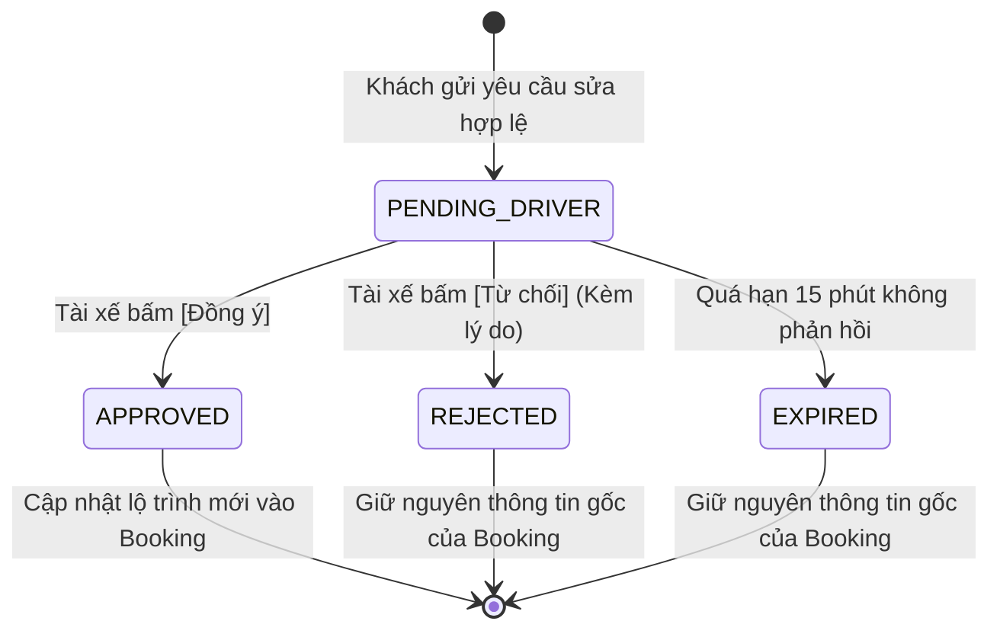
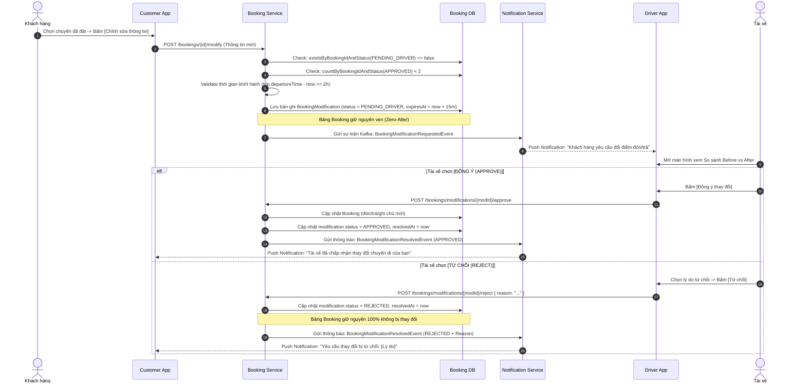

# KẾ HOẠCH TRIỂN KHAI: CHỈNH SỬA THÔNG TIN ĐẶT XE CÓ KIỂM SOÁT & TÀI XẾ DUYỆT LẠI (REQ-P3-01)

> **Tài liệu Kỹ thuật & Thiết kế Kiến trúc Vi dịch vụ (Senior Backend & Software Architect)**  
> **Dự án**: Nền tảng Đặt xe ghép liên tỉnh RideUp (RideUpMicro)  
> **Module liên quan**: `booking-service`, `notification-service`, `rideup-customer-app`, `rideup-driver-app`  
> **Mục tiêu**: Cung cấp tính năng cho phép hành khách điều chỉnh linh hoạt điểm đón, điểm trả, số điện thoại người đi và ghi chú sau khi đã đặt vé, đồng thời thiết lập cơ chế kiểm soát an toàn nghiêm ngặt để tài xế xem xét và duyệt trước khi thay đổi có hiệu lực.

---

## 1. BỐI CẢNH VÀ MỤC TIÊU NGHIỆP VỤ

### 1.1. Vấn đề thực tế của mô hình Xe ghép liên tỉnh
* **Khách hàng phát sinh thay đổi**: Trong thực tế đặt xe liên tỉnh, hành khách thường có nhu cầu thay đổi nhẹ về điểm đón (VD: chuyển từ số 12 sang số 88 cùng trên một trục đường), đổi điểm trả (VD: chuyển sang cổng bệnh viện), đổi số điện thoại người đi thực tế (đặt hộ người thân), hoặc bổ sung ghi chú (vali to, có trẻ nhỏ).
* **Rủi ro nếu hủy vé đặt lại**:
  - Khách hàng bị mất chỗ nếu chuyến xe đã gần kín chỗ.
  - Phí sàn và dòng tiền thanh toán thẻ qua Stripe Escrow bị hoàn trả phức tạp nếu khách phải hủy vé.
  - Tài xế hoang mang vì thấy cuốc bị hủy rồi đặt lại liên tục.
* **Mục tiêu giải pháp**: Xây dựng quy trình **Yêu cầu Chỉnh sửa (Booking Modification Request)**:
  - Khách gửi yêu cầu cập nhật thông tin lộ trình/liên hệ.
  - Tài xế nhận thông báo tức thời, xem giao diện so sánh trực quan (Before vs After) kèm khoảng cách lệch km.
  - Tài xế có toàn quyền **Chấp thuận (Approve)** hoặc **Từ chối (Reject)** để bảo đảm không bị phá vỡ lộ trình chính của chuyến xe.

---

## 2. MA TRẬN PHÂN LOẠI TRƯỜNG & QUY TẮC RÀNG BUỘC (VALIDATION MATRIX)

### 2.1. Phân loại trường dữ liệu
Để bảo đảm tính toàn vẹn của hệ thống tài chính và thuật toán giữ chỗ, hệ thống phân định rõ:

| Nhóm trường | Danh sách trường | Hành vi cho phép |
| :--- | :--- | :--- |
| **ĐƯỢC PHÉP CHỈNH SỬA** | `pickupAddressText`, `pickupLat`, `pickupLng`, `pickupWardId`<br>`dropoffAddressText`, `dropoffLat`, `dropoffLng`, `dropoffWardId`<br>`passengerName`, `passengerPhone`<br>`note` | Cho phép cập nhật; dữ liệu mới được lưu tạm tại bảng `booking_modifications` để tài xế duyệt. |
| **NGHIÊM CẤM CHỈNH SỬA** | `seatCount` (Số lượng ghế)<br>`tripId` (Chuyến đi)<br>`paymentMethod` (Phương thức thanh toán)<br>`pricePerSeat`, `totalAmount` (Giá vé) | **Bất biến**. Nếu khách muốn đổi số ghế hoặc đổi chuyến xe, bắt buộc phải thực hiện quy trình Hủy vé cũ và Đặt vé mới. |

### 2.2. Các quy tắc nghiệp vụ cốt lõi (Validation Rules)

1. **Quy tắc 1 - Trạng thái vé hợp lệ**:
   - Chỉ cho phép gửi yêu cầu chỉnh sửa khi `Booking.status` đang là `CONFIRMED` (Đã xác nhận) hoặc `WAITING_DRIVER_APPROVAL` (Đang chờ tài xế duyệt đơn ban đầu).
   - Tuyệt đối chặn nếu chuyến xe đã bắt đầu (`IN_PROGRESS`), đã hoàn thành (`COMPLETED`), hoặc vé đã hủy (`CANCELLED`).
2. **Quy tắc 2 - Khung thời gian tối thiểu (Cut-off Time)**:
   - Yêu cầu sửa đổi phải được gửi trước giờ khởi hành tối thiểu **02 giờ**:
     `trip.departureTime - now >= 2 giờ`.
   - Nếu dưới 2 giờ, hệ thống khóa tính năng sửa đổi để tài xế tập trung điều khiển phương tiện đón khách đúng giờ.
3. **Quy tắc 3 - Kiểm soát tần suất & Tính duy nhất (Concurrency Control)**:
   - Mỗi đơn đặt vé chỉ được chỉnh sửa tối đa **02 lần thành công** (kiểm tra qua `bookingModificationRepository.countByBookingIdAndStatus(bookingId, APPROVED) < 2`).
   - Tại một thời điểm, chỉ cho phép **tối đa 01 yêu cầu đang chờ duyệt** (kiểm tra tức thì qua index: `bookingModificationRepository.existsByBookingIdAndStatus(bookingId, PENDING_DRIVER) == false`). Khách không được gửi yêu cầu mới khi yêu cầu cũ chưa kết thúc.
4. **Quy tắc 4 - Thời hạn xem xét của Tài xế (Timeout)**:
   - Tài xế có thời hạn tối đa **15 phút** kể từ lúc khách gửi để duyệt (hoặc trước giờ xuất phát 30 phút, tùy mốc nào đến trước).
   - Nếu quá 15 phút tài xế không phản hồi, hệ thống tự động chuyển trạng thái sang `EXPIRED`, giữ nguyên thông tin vé ban đầu và gửi thông báo cho khách.

---

## 3. THIẾT KẾ CƠ SỞ DỮ LIỆU & MÔ HÌNH THỰC THỂ

### 3.1. Bảng dữ liệu mới: `booking_modifications` (tại `booking-service`)

Bảng mới duy nhất được tạo trong database để quản lý vòng đời yêu cầu chỉnh sửa và snapshot dữ liệu đối soát:

```sql
CREATE TABLE booking_modifications (
    id VARCHAR(36) PRIMARY KEY,
    booking_id VARCHAR(36) NOT NULL,
    customer_id VARCHAR(36) NOT NULL,
    trip_id VARCHAR(36) NOT NULL,
    
    -- Dữ liệu mới đề xuất
    new_pickup_address_text VARCHAR(255),
    new_pickup_lat DOUBLE PRECISION,
    new_pickup_lng DOUBLE PRECISION,
    new_pickup_ward_id VARCHAR(50),
    
    new_dropoff_address_text VARCHAR(255),
    new_dropoff_lat DOUBLE PRECISION,
    new_dropoff_lng DOUBLE PRECISION,
    new_dropoff_ward_id VARCHAR(50),
    
    new_passenger_name VARCHAR(100),
    new_passenger_phone VARCHAR(20),
    new_note TEXT,
    
    -- Dữ liệu cũ chụp lại (Snapshot) để so sánh Before/After & Audit
    old_pickup_address_text VARCHAR(255),
    old_pickup_lat DOUBLE PRECISION,
    old_pickup_lng DOUBLE PRECISION,
    old_dropoff_address_text VARCHAR(255),
    old_dropoff_lat DOUBLE PRECISION,
    old_dropoff_lng DOUBLE PRECISION,
    old_passenger_name VARCHAR(100),
    old_passenger_phone VARCHAR(20),
    old_note TEXT,
    
    -- Trạng thái & Lý do
    status VARCHAR(30) NOT NULL, -- PENDING_DRIVER, APPROVED, REJECTED, EXPIRED
    rejection_reason VARCHAR(255),
    
    -- Thời hạn phản hồi
    expires_at TIMESTAMP NOT NULL,
    resolved_at TIMESTAMP,
    
    created_at TIMESTAMP NOT NULL DEFAULT CURRENT_TIMESTAMP,
    updated_at TIMESTAMP DEFAULT CURRENT_TIMESTAMP ON UPDATE CURRENT_TIMESTAMP,
    
    INDEX idx_mod_booking_status (booking_id, status),
    INDEX idx_mod_trip_status (trip_id, status),
    INDEX idx_mod_status_expires (status, expires_at)
);
```

### 3.2. Quyết định Kiến trúc Database: Áp dụng Phương án 2 (Zero-Alter Table)

Để bảo đảm an toàn tuyệt đối cho bảng giao dịch lõi `booking`, hệ thống áp dụng nguyên tắc **Zero-Alter Table**:

1. **Giữ nguyên 100% cấu trúc bảng `booking`**:
   - **Tuyệt đối không chạy lệnh `ALTER TABLE booking`**, không thêm bất kỳ cột mới nào.
   - Tránh hoàn toàn rủi ro khóa bảng (Table Lock), lỗi migration, hoặc lệch trạng thái cờ giữa các bảng.
2. **Kiểm tra trạng thái chờ duyệt (Pending Check)**:
   - Thay vì cờ boolean trên `booking`, Service kiểm tra trực tiếp qua index của bảng `booking_modifications`:
     ```java
     boolean hasPending = bookingModificationRepository
         .existsByBookingIdAndStatus(bookingId, ModificationStatus.PENDING_DRIVER);
     ```
   - Nhờ index `idx_mod_booking_status (booking_id, status)`, câu query này thực thi tức thì ($< 1\text{ms}$).
3. **Kiểm tra giới hạn số lần sửa (Rate Limit Check)**:
   - Đếm số lần chỉnh sửa đã được duyệt thành công:
     ```java
     long approvedCount = bookingModificationRepository
         .countByBookingIdAndStatus(bookingId, ModificationStatus.APPROVED);
     if (approvedCount >= 2) {
         throw new AppException(ErrorCode.MAX_MODIFICATIONS_EXCEEDED);
     }
     ```
4. **Cơ chế cập nhật dữ liệu khi Tài xế bấm Duyệt (`APPROVED`)**:
   - Chỉ cập nhật các trường địa chỉ đón/trả và ghi chú **đã có sẵn** trên thực thể `Booking`:
     ```java
     booking.setPickupWardId(mod.getNewPickupWardId());
     booking.setPickupLat(mod.getNewPickupLat());
     booking.setPickupLng(mod.getNewPickupLng());
     booking.setPickupAddressText(mod.getNewPickupAddressText());

     booking.setDropoffWardId(mod.getNewDropoffWardId());
     booking.setDropoffLat(mod.getNewDropoffLat());
     booking.setDropoffLng(mod.getNewDropoffLng());
     booking.setDropoffAddressText(mod.getNewDropoffAddressText());

     // Nếu có đổi tên/SĐT người đi hộ, cập nhật thông tin rõ ràng vào note
     if (StringUtils.hasText(mod.getNewPassengerPhone())) {
         booking.setNote("[Người đi: " + mod.getNewPassengerName() + " - " + mod.getNewPassengerPhone() + "] " + (mod.getNewNote() != null ? mod.getNewNote() : ""));
     } else if (mod.getNewNote() != null) {
         booking.setNote(mod.getNewNote());
     }
     ```
   - Thông tin người đi hộ vẫn được lưu vết độc lập đầy đủ trong bản ghi `BookingModification` để phục vụ tra cứu lịch sử và đối soát.

---

## 4. QUY TRÌNH XỬ LÝ & SƠ ĐỒ TRẠNG THÁI (STATE MACHINE)

### 4.1. Sơ đồ trạng thái yêu cầu chỉnh sửa



### 4.2. Sơ đồ tuần tự tương tác (Sequence Diagram)



### 4.3. Xử lý kịch bản quá hạn (Timeout Scheduler)
* Một tác vụ ngầm định kỳ chạy mỗi 60 giây (`@Scheduled(cron = "0 * * * * *")`):
  ```sql
  SELECT * FROM booking_modifications 
  WHERE status = 'PENDING_DRIVER' AND expires_at <= NOW();
  ```
* Hệ thống tự động chuyển trạng thái các bản ghi này sang `EXPIRED` (chỉ cập nhật trên bảng `booking_modifications`, hoàn toàn không cần tác động vào bảng `booking`).
* Phát thông báo đến khách hàng: *"Yêu cầu chỉnh sửa của bạn đã hết hạn do tài xế chưa kịp phản hồi. Thông tin vé cũ được giữ nguyên an toàn."*

---

## 5. ĐẶC TẢ CHI TIẾT API CONTRACTS

### 5.1. Khách hàng gửi yêu cầu chỉnh sửa
* **Endpoint**: `POST /bookings/{id}/modify`
* **Quyền hạn**: Khách hàng sở hữu vé (`ROLE_USER`)
* **Request Body**:
```json
{
  "pickupAddressText": "Số 88 đường Giải Phóng, Giáp Bát, Hoàng Mai",
  "pickupLat": 20.985612,
  "pickupLng": 105.842311,
  "pickupWardId": "ward_001",
  "dropoffAddressText": "Cổng Bệnh viện Đa khoa tỉnh Ninh Bình",
  "dropoffLat": 20.254122,
  "dropoffLng": 105.975412,
  "dropoffWardId": "ward_050",
  "passengerName": "Nguyễn Văn An",
  "passengerPhone": "0987654321",
  "note": "Đổi sang số điện thoại mẹ em đi hộ, có thêm 1 vali to"
}
```
* **Response (200 OK)**:
```json
{
  "code": 1000,
  "message": "Gửi yêu cầu chỉnh sửa thành công. Vui lòng chờ tài xế duyệt trong 15 phút.",
  "result": {
    "modificationId": "mod_uuid_9988",
    "bookingId": "bk_uuid_1122",
    "status": "PENDING_DRIVER",
    "expiresAt": "2026-10-29T17:45:00",
    "remainingModifications": 1
  }
}
```

### 5.2. Tài xế phê duyệt yêu cầu chỉnh sửa
* **Endpoint**: `POST /bookings/modifications/{modId}/approve`
* **Quyền hạn**: Tài xế của chuyến xe (`ROLE_DRIVER`)
* **Response (200 OK)**:
```json
{
  "code": 1000,
  "message": "Phê duyệt thay đổi thành công. Lộ trình chuyến đi đã được cập nhật.",
  "result": {
    "bookingId": "bk_uuid_1122",
    "modificationId": "mod_uuid_9988",
    "status": "APPROVED",
    "resolvedAt": "2026-10-29T17:35:10"
  }
}
```

### 5.3. Tài xế từ chối yêu cầu chỉnh sửa
* **Endpoint**: `POST /bookings/modifications/{modId}/reject`
* **Quyền hạn**: Tài xế của chuyến xe (`ROLE_DRIVER`)
* **Request Body**:
```json
{
  "reason": "Lộ trình mới đi vào ngõ hẹp xe ô tô 7 chỗ không quay đầu được"
}
```
* **Response (200 OK)**:
```json
{
  "code": 1000,
  "message": "Đã từ chối yêu cầu chỉnh sửa. Thông tin vé cũ được giữ nguyên.",
  "result": {
    "bookingId": "bk_uuid_1122",
    "modificationId": "mod_uuid_9988",
    "status": "REJECTED",
    "rejectionReason": "Lộ trình mới đi vào ngõ hẹp xe ô tô 7 chỗ không quay đầu được"
  }
}
```

### 5.4. Lấy chi tiết & Lịch sử sửa đổi
* `GET /bookings/{id}/modifications`: Khách hàng và tài xế xem danh sách các lần yêu cầu chỉnh sửa của vé.
* `GET /bookings/driver/pending-modifications`: Danh sách các yêu cầu sửa đổi đang chờ tài xế duyệt (phục vụ hiển thị Badge đỏ và danh sách trên Driver App).

---

## 6. THIẾT KẾ GIAO DIỆN & TRẢI NGHIỆM NGƯỜI DÙNG (FRONTEND UI/UX)

### 6.1. Trên App Khách Hàng (`rideup-customer-app`)
1. **Tại Màn hình Chi tiết vé (`BookingDetailScreen` / `MyTrips`)**:
   - Nếu `booking.status == 'CONFIRMED'` và thời gian đến giờ khởi hành `> 2h`: Hiển thị nút phụ **"✏️ Chỉnh sửa điểm đón/trả"**.
   - Nếu vé đang có yêu cầu ở trạng thái `PENDING_DRIVER`: Nút chuyển sang trạng thái chờ với badge màu hổ phách: **"⏳ Đang chờ tài xế duyệt thay đổi"** kèm đồng hồ đếm ngược 15 phút (khóa không cho gửi thêm yêu cầu mới).
2. **Modal Form Chỉnh sửa (`EditBookingModal`)**:
   - Tái sử dụng bộ chọn địa điểm (Địa chỉ chi tiết, Phường/Xã).
   - Form nhập tên và số điện thoại người đi.
   - Ô nhập ghi chú lý do đổi.
   - Nút hành động: **[GỬI YÊU CẦU CHO TÀI XẾ]**.

### 6.2. Trên App Tài Xế (`rideup-driver-app`)
1. **Banner thông báo & Tab Chờ duyệt trên Dashboard**:
   - Khi có sự kiện từ Kafka/Socket: Hiển thị thanh thông báo nổi bật màu cam vàng:
     > *"Khách hàng [Tên khách] vừa yêu cầu đổi điểm đón/trả (Còn lại 14:30s)"*
2. **Màn hình Phê duyệt So sánh Trực quan (`BookingModificationReviewModal`)**:
   - **Giao diện Before vs After**:
     - *Điểm đón cũ*: Ghim xám `#64748B` -> *Điểm đón mới*: Ghim xanh dương `#0EA5E9` (kèm dòng chữ nhỏ hiển thị khoảng cách ước tính: *Lệch +0.8 km*).
     - *Điểm trả cũ* vs *Điểm trả mới*.
     - *Thông tin người đi mới* & *Ghi chú của khách*.
   - **2 nút bấm rõ ràng**:
     - **[TỪ CHỐI]**: Mở danh sách lý do nhanh (Đường cấm ô tô, Lệch lộ trình quá xa, Sát giờ xuất phát) hoặc tự nhập.
     - **[ĐỒNG Ý CẬP NHẬT]**: Nút chính màu xanh lá, bấm vào áp dụng ngay lộ trình mới.

---

## 7. KẾ HOẠCH TRIỂN KHAI THEO TỪNG BƯỚC (ROADMAP)

### Giai đoạn Backend (`booking-service` & `notification-service`)
1. Tạo thực thể `BookingModification` và migration/DDL bảng `booking_modifications`.
2. Áp dụng chuẩn **Zero-Alter Table**: Giữ nguyên 100% cấu trúc thực thể và bảng `Booking`.
3. Tạo `BookingModificationRepository` với các query tối ưu index:
   - `existsByBookingIdAndStatus(bookingId, PENDING_DRIVER)`
   - `countByBookingIdAndStatus(bookingId, APPROVED)`
   - `findByTripIdAndStatus(tripId, PENDING_DRIVER)`
   - `findByStatusAndExpiresAtLessThanEqual(PENDING_DRIVER, now)`
4. Viết Service logic (`BookingModificationService`):
   - `requestBookingModification`: Kiểm tra 4 quy tắc ràng buộc, snapshot dữ liệu cũ, lưu bản ghi mới, phát Kafka event.
   - `approveBookingModification`: Cập nhật trạng thái `APPROVED`, gán dữ liệu đón/trả/ghi chú mới vào `Booking`.
   - `rejectBookingModification`: Cập nhật trạng thái `REJECTED`, lưu lý do từ chối.
   - Scheduled job quét `EXPIRED` mỗi 1 phút.
5. Tạo Controller endpoints tại `BookingModificationController`.
6. Cấu hình Kafka Producer trong `booking-service` và Consumer trong `notification-service` để push notification tới App.

### Giai đoạn Frontend Mobile
1. Cập nhật `rideup-customer-app`:
   - Thêm API calls trong `services/apiService.js`: `requestBookingModification`, `getBookingModifications`.
   - Thêm nút và Modal chỉnh sửa trong màn hình quản lý chuyến/vé.
2. Cập nhật `rideup-driver-app`:
   - Thêm API calls trong `services/apiService.js`: `getPendingModifications`, `approveModification`, `rejectModification`.
   - Thêm UI so sánh Before/After và popup duyệt sửa đổi trên `DriverDashboardScreen`.

---

## 8. TIÊU CHUẨN NGHIỆM THU (ACCEPTANCE CRITERIA)

1. Khách hàng không thể chỉnh sửa khi chuyến đi còn dưới 2 giờ khởi hành.
2. Khách hàng không thể chỉnh sửa số ghế hoặc giá tiền.
3. Không thể gửi yêu cầu thứ 2 khi yêu cầu thứ 1 đang ở trạng thái `PENDING_DRIVER`.
4. Không thể chỉnh sửa quá 2 lần thành công trên cùng 1 mã vé.
5. Tài xế bấm Duyệt -> Dữ liệu vé lập tức đổi sang địa chỉ mới, khách nhận thông báo realtime.
6. Tài xế bấm Từ chối -> Dữ liệu vé giữ nguyên như cũ, khách nhận được lý do từ chối.
7. Quá 15 phút tài xế không phản hồi -> Hệ thống tự động chuyển sang `EXPIRED`, vé giữ nguyên vẹn.
